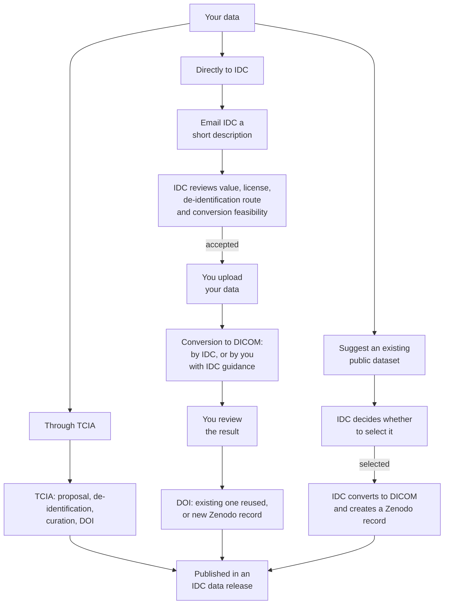

# Contributing data

IDC hosts public, de-identified cancer imaging data and image-derived data, all in DICOM format. This page explains the ways data gets into IDC, what IDC requires, and what to expect if you contribute.

Once your data is in IDC:

* it can be searched and viewed in the [IDC Portal](https://portal.imaging.datacommons.cancer.gov/explore/), next to the rest of IDC's collections
* all of its DICOM metadata can be searched with SQL, together with the metadata of every other IDC collection
* it can be downloaded free of charge and without login from public cloud buckets, using [idc-index](data/downloading-data/downloading-data.md) and other [standard tools](data/downloading-data/)
* LLM assistants can find it, select subsets of it and generate download commands through the [IDC MCP server and agent skill](agents/README.md)
* the dataset has a DOI and can be cited, and every file carries that DOI, so users of your data are pointed to the citation

## Ways data gets into IDC

There are three routes:

* **through The Cancer Imaging Archive (TCIA)**
* **directly to IDC**
* **IDC selects an existing public dataset**, which anyone can suggest

### Through TCIA

[TCIA](https://www.cancerimagingarchive.net/) works with data submitters to de-identify, curate and publish cancer imaging collections, and assigns each one a DOI. IDC is the only place to download the public DICOM collections that TCIA publishes. A collection submitted through TCIA reaches IDC users this way.

TCIA also accepts and distributes data that is not in DICOM, which IDC does not host. If your data cannot be converted to DICOM, TCIA may be the better route. Contact TCIA directly for its submission process.

TCIA is one route, not the only one.

### Directly to IDC

You can contribute two kinds of data directly:

* **Original collections**, meaning images that are not yet in IDC. IDC prioritizes NCI-funded driving projects and selected initiatives. Other strong datasets can be proposed and are reviewed case by case, without a guarantee of acceptance.
* **Derived data for images already in IDC**: expert annotations, segmentations and other results produced by ML models, radiomics features, quality labels and similar. Anyone may apply. Acceptance depends on the value of the contribution. IDC's capacity limits how many contributions it can take on and when.

[How a direct contribution works](#how-a-direct-contribution-works) describes the steps.

### Suggest an existing dataset

IDC does not just wait for submissions. It also identifies existing public datasets and converts them to DICOM itself, choosing them for their value and other factors. You can suggest a dataset for IDC to consider, whether you authored it or not, by emailing [support+submissions@canceridc.dev](mailto:support+submissions@canceridc.dev).

Only datasets with a permissive license and evidence of value are considered. IDC decides which suggestions to take on.

When IDC converts a published dataset, the Zenodo record for the DICOM version always cites and acknowledges the source. When the source has a DOI, the record's metadata links to it as the dataset the DICOM version is derived from.

When IDC selects a dataset, it tries to reach the original authors. It invites them to take part in the conversion and to review the results. Authors who contribute are invited to be listed as co-authors of the Zenodo record for the DICOM version. IDC cannot list anyone as a co-author without their contribution and consent.

## What IDC requires

IDC stakeholders decide which contributions are accepted. They are the IDC team leads, project managers and federal leads. Every contribution is reviewed individually, and acceptance is not guaranteed.

### Public access and license

IDC only hosts public data. Your data must be available to anyone without a data use or data transfer agreement.

[CC BY 4.0](https://creativecommons.org/licenses/by/4.0/) is strongly preferred. Non-commercial licenses are strongly discouraged and are considered only under exceptional circumstances. See [Licensing and attribution](data/licensing.md) for how licenses apply to IDC data.

Why CC BY:

* **It lets everyone use the data.** IDC's goal is to accelerate scientific discovery and the search for cancer cures. Academic and commercial researchers both do that work, and a non-commercial (NC) license excludes the commercial ones.
* **NC licenses leave model training in doubt.** It is not settled whether a model trained on NC data is itself bound by the NC clause. There is no established precedent, and it has been argued that trained model weights may be considered a derivative work of the training data ([Franceschelli et al., 2024](https://doi.org/10.48550/arXiv.2407.13493)).

### Evidence of value

Tell IDC why the data is worth hosting. Examples:

* the data was collected under a competitive research grant
* the data is described in a peer-reviewed publication
* for manual annotations: the qualifications of the experts who made them
* for ML results: published or otherwise established performance of the model, and documented quality assurance

### De-identification


IDC does not de-identify data, and does not check the results of de-identification. Making sure the data is de-identified is your responsibility.


You have two options:

* **Use an entity IDC already recognizes as qualified to de-identify your type of data.** IDC has already reviewed how such an entity de-identifies data, so it does not review that again for each dataset.
* **De-identify the data yourself, or use an entity IDC has not reviewed before.** In this case you submit documentation describing how the data was de-identified. IDC reviews the documentation, but not the data, and gives you feedback. Acceptance is not guaranteed.

How closely IDC reviews the documentation depends on the type of data:

* **Digital pathology slides in vendor formats** are easier. IDC converts them to DICOM and controls which metadata is carried over.
* **DICOM radiology** is riskier, because identifying information can remain in many places in the DICOM headers and in the pixel data. TCIA is currently the only entity IDC recognizes as qualified to de-identify DICOM radiology.

### DICOM format

All data in IDC is in DICOM. If your data is in another format, IDC considers it only when conversion to DICOM is feasible. IDC then either converts it or guides you through the conversion (see [Preparing your data in DICOM](#preparing-your-data-in-dicom)).

## How a direct contribution works

1. **Get in touch first.** Email [support+submissions@canceridc.dev](mailto:support+submissions@canceridc.dev) before you convert or upload anything. Keep this first email brief. A sentence or two on each of the points below is enough for IDC's initial assessment, and you don't need to prepare detailed documentation at this stage. Cover:
   * what the data is: images or derived data, modalities, cancer types, number of subjects, approximate size
   * for derived data, which IDC collections it applies to
   * the current format, and where the data is now (for example, whether it is already published with a DOI)
   * how it was de-identified, and by whom
   * the license you intend to use
   * evidence of value, as described [above](#evidence-of-value)
   * whether clinical data accompanies the images
2. **Review.** IDC reviews your proposal and replies with feedback. If it looks promising, IDC sends you a metadata template to describe the dataset. Unless the data was de-identified by an entity IDC already recognizes, IDC also asks for documentation of how it was de-identified.
3. **Upload.** If your contribution is accepted, IDC gives you a location to upload your data and explains how.
4. **Conversion.** If your data is not in DICOM, IDC converts it, or you convert it with IDC's guidance. IDC works with you to choose the appropriate DICOM object type.
5. **Review before release.** IDC gives you access to view the converted data and its metadata, so you can confirm it is correct before it is published.
6. **DOI.**
   * If your data was already in DICOM and published with a DOI, that DOI is reused.
   * If IDC converted your data, IDC creates a record with its own DOI for the DICOM version in the [NCI Imaging Data Commons Zenodo community](https://zenodo.org/communities/nci-idc/). The record always cites and acknowledges your original dataset. When that dataset has a DOI, the record's metadata links to it as the source the DICOM version is derived from (Zenodo's "is derived from" relation). Its co-authors are the people who collected the data, the people outside the IDC team who helped with the conversion, and the IDC team members who worked on the conversion.
7. **Release.** Your data is published in a future IDC data release and listed in the [data release notes](data/data-release-notes.md). IDC does not commit to a date: timing depends on the data and on IDC's capacity.

## Preparing your data in DICOM


Converting data to DICOM is currently not easy. Please get in touch with IDC before you spend much time on conversion. IDC is happy for you to do the conversion yourself and will advise and guide you. Conversion results that have issues may need to be redone, and we do not want to waste your time.


IDC will confirm the right DICOM representation for your data before you start. As a rough guide:

| Data | DICOM object | Read more |
| --- | --- | --- |
| Segmentations of radiology or pathology images | Segmentation (SEG) | [DICOM Segmentations](dicom/derived-objects/dicom-segmentations.md) |
| Measurements, qualitative evaluations, point and region annotations | Structured Report (SR) | [DICOM Structured Reports](dicom/derived-objects/dicom-structured-reports.md) |
| Large numbers of annotations on slides, such as nuclei outlines | Microscopy Bulk Simple Annotations (ANN) | [highdicom user guide](https://highdicom.readthedocs.io/en/latest/ann.html) |
| Whole slide images | Slide Microscopy (SM) | [Implementing the DICOM standard for digital pathology](https://doi.org/10.4103/jpi.jpi_42_18) |

Annotations need standard codes to describe what was annotated. See [Coding schemes](dicom/coding-schemes.md).

Open-source tools that can help:

* [dcmqi](https://github.com/QIICR/dcmqi): command-line tools that need no programming; you describe the content in JSON files. They convert segmentations from research formats such as NIfTI and NRRD into DICOM SEG, and tabular data, such as radiomics features derived from segmentations, into DICOM SR.
* [highdicom](https://github.com/ImagingDataCommons/highdicom): a Python library for creating DICOM SEG, SR, ANN and other objects. Using it means writing Python code.
* [wsidicomizer](https://github.com/imi-bigpicture/wsidicomizer): converts whole slide images from vendor formats into DICOM SM
* [dciodvfy](https://www.dclunie.com/dicom3tools.html), part of dicom3tools: checks DICOM files against the standard (can be installed from the [PyPI dicom3tools package](https://pypi.org/project/dicom3tools/))

For a complete conversion example, see [rcc-aid-conversion](https://github.com/ImagingDataCommons/rcc-aid-conversion). It converts the RCC-AID kidney annotations from NIfTI to DICOM SEG, with notes on terminology and on the problems found along the way.

## Clinical data

Clinical data that accompanies the images is welcome. It must be:

* de-identified under the same rules as the images
* supplied as tables (CSV or XLSX) with a data dictionary that defines each column and value
* linkable to the images by patient, using the DICOM PatientID

IDC loads the dictionaries and the clinical data tables into BigQuery tables, and also makes them available and searchable through the [idc-index](https://pypi.org/project/idc-index/) Python package. See [Clinical data](data/organization-of-data/clinical.md).

## After publication

**Corrections and additions.** Email [support+submissions@canceridc.dev](mailto:support+submissions@canceridc.dev) to request changes. Changes are published in a later IDC release as a new version of your data, and the earlier versions stay available so that analyses done on them can be reproduced. See [Data versioning](data/data-versioning.md).

**Withdrawal.** If identifying information about patients (PHI/PII) is found in published data, IDC removes the affected data from all versions. Any other request to withdraw published data is reviewed case by case by IDC stakeholders.

## Examples

| Route | Dataset | What happened |
| --- | --- | --- |
| Through TCIA | LIDC-annot-NLST501 ([10.7937/y2dx-e334](https://doi.org/10.7937/y2dx-e334)) | Median Technologies published lung nodule segmentations on 501 NLST chest CT scans through TCIA, with the segmentations already converted to DICOM. IDC distributes the DICOM; the NIfTI masks and CSV tables remain on TCIA. |
| Direct: original collection | BoneMarrowWSI-PediatricLeukemia ([10.5281/zenodo.14933087](https://doi.org/10.5281/zenodo.14933087)) | Bone marrow aspirate smear slides with expert annotations and clinical data for 246 pediatric leukemia cases. Converted to DICOM SM and ANN by IDC. |
| Direct: derived data | RMS-Mutation-Prediction-Expert-Annotations ([10.5281/zenodo.10462857](https://doi.org/10.5281/zenodo.10462857)) | Expert annotations of the slides in the RMS-Mutation-Prediction collection already in IDC. Converted to DICOM by IDC. |
| Selected by IDC | RCC-AID ([10.5281/zenodo.22284133](https://doi.org/10.5281/zenodo.22284133)) | Kidney, tumor and cyst annotations of TCGA CT scans, published in NIfTI under CC BY 4.0 ([10.5281/zenodo.20719257](https://doi.org/10.5281/zenodo.20719257)). IDC selected the dataset and converted it to DICOM SEG. |
| Selected by IDC | Pan-Cancer-Nuclei-Seg-DICOM ([10.5281/zenodo.11099004](https://doi.org/10.5281/zenodo.11099004)) | Nuclei segmentations of TCGA slides, distributed by TCIA in non-DICOM form ([10.7937/TCIA.2019.4A4DKP9U](https://doi.org/10.7937/TCIA.2019.4A4DKP9U)). IDC prioritized the dataset and converted it to DICOM SEG and ANN. |

## Questions

Email [support+submissions@canceridc.dev](mailto:support+submissions@canceridc.dev) about contributing data. For other questions about IDC, post on the [IDC User Forum](https://discourse.canceridc.dev/).
