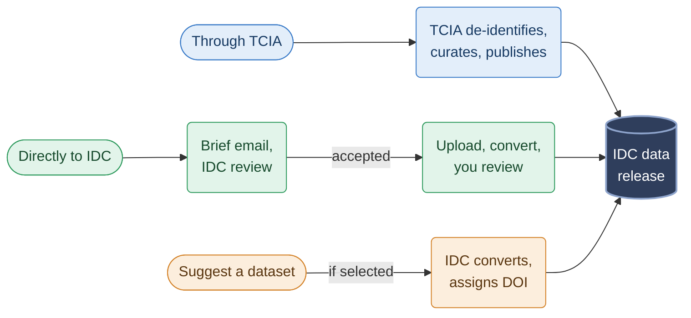

# Contributing data

IDC hosts public, de-identified cancer imaging data and image-derived data, all in DICOM format. This page explains the ways data gets into IDC. The pages in this section cover:

* [Requirements](requirements.md): what IDC requires of a contribution
* [Contribution process](contribution-process.md): the steps from the first email to publication
* [Annotating images in IDC](annotating-images-in-idc.md): how to annotate or analyze images in IDC so that the results can be converted to DICOM
* [Preparing data in DICOM](preparing-data-in-dicom.md): guidance and tools for converting data yourself

Once your data is in IDC:

* it can be searched and viewed in the [IDC Portal](https://portal.imaging.datacommons.cancer.gov/explore/), next to the rest of IDC's collections
* all of its DICOM metadata can be searched with SQL, together with the metadata of every other IDC collection
* it can be downloaded free of charge and without login from public cloud buckets, using [idc-index](../data/downloading-data/downloading-data.md) and other [standard tools](../data/downloading-data/)
* LLM assistants can find it, select subsets of it and generate download commands through the [IDC MCP server and agent skill](../agents/README.md)
* the dataset has a DOI and can be cited, and every file carries that DOI, so users of your data are pointed to the citation

## Ways data gets into IDC

There are three routes:

* [**through The Cancer Imaging Archive (TCIA)**](#through-tcia)
* [**directly to IDC**](#directly-to-idc)
* [**IDC selects an existing public dataset**](#suggest-an-existing-dataset), which anyone can suggest

### Through TCIA

[TCIA](https://www.cancerimagingarchive.net/) works with data submitters to de-identify, curate and publish cancer imaging collections, and assigns each one a DOI. IDC is the only place to download the public DICOM collections that TCIA publishes. A collection submitted through TCIA reaches IDC users this way.

TCIA also accepts and distributes data that is not in DICOM, which IDC does not host. If your data cannot be converted to DICOM, TCIA may be the better route. Contact TCIA directly for its submission process.

TCIA is one route, not the only one. If you have annotations or analysis results for images already in IDC, contribute them [directly to IDC](#directly-to-idc) instead.

### Directly to IDC

You can contribute two kinds of data directly:

* **Original collections**, meaning images that are not yet in IDC. IDC prioritizes NCI-funded driving projects and selected initiatives. Other strong datasets can be proposed and are reviewed case by case, without a guarantee of acceptance.
* **Derived data for images already in IDC**: expert annotations, segmentations and other results produced by ML models, radiomics features, quality labels and similar. Anyone may apply. Acceptance depends on the value of the contribution. IDC's capacity limits how many contributions it can take on and when.


If you have annotations or analysis results for images already in IDC, please contribute them directly to IDC rather than through TCIA. This makes the process simpler and the conversion to DICOM more straightforward, and your results are likely to be available in IDC sooner.


See [Requirements](requirements.md) for what IDC requires, and [Contribution process](contribution-process.md) for the steps.

### Suggest an existing dataset

IDC does not just wait for submissions. It also identifies existing public datasets and converts them to DICOM itself, choosing them for their value and other factors. You can suggest a dataset for IDC to consider, whether you authored it or not, by emailing [support+submissions@canceridc.dev](mailto:support+submissions@canceridc.dev).

Only datasets with a permissive license and evidence of value are considered. IDC decides which suggestions to take on.

When IDC converts a published dataset, the Zenodo record for the DICOM version always cites and acknowledges the source. When the source has a DOI, the record's metadata links to it as the dataset the DICOM version is derived from.

When IDC selects a dataset, it tries to reach the original authors. It invites them to take part in the conversion and to review the results. Authors who contribute are invited to be listed as co-authors of the Zenodo record for the DICOM version. IDC cannot list anyone as a co-author without their contribution and consent.

## Examples

| Route | Dataset | What happened |
| --- | --- | --- |
| Through TCIA | MRI-DIR ([10.7937/K9/TCIA.2018.3f08iejt](https://doi.org/10.7937/K9/TCIA.2018.3f08iejt)) | MR and CT images of a porcine phantom and of synthetic head and neck subjects, built at MD Anderson to measure the accuracy of deformable image registration, and published by TCIA. IDC distributes the DICOM images; the deformation vector fields, a MATLAB package, remain on TCIA. |
| Direct: original collection | BoneMarrowWSI-PediatricLeukemia ([10.5281/zenodo.14933087](https://doi.org/10.5281/zenodo.14933087)) | Bone marrow aspirate smear slides with expert annotations and clinical data for 246 pediatric leukemia cases. Converted to DICOM SM and ANN by IDC. |
| Direct: derived data | RMS-Mutation-Prediction-Expert-Annotations ([10.5281/zenodo.10462857](https://doi.org/10.5281/zenodo.10462857)) | Expert annotations of the slides in the RMS-Mutation-Prediction collection already in IDC. Converted to DICOM by IDC. |
| Selected by IDC | RCC-AID ([10.5281/zenodo.22284133](https://doi.org/10.5281/zenodo.22284133)) | Kidney, tumor and cyst annotations of TCGA CT scans, published in NIfTI under CC BY 4.0 ([10.5281/zenodo.20719257](https://doi.org/10.5281/zenodo.20719257)). IDC selected the dataset and converted it to DICOM SEG. |
| Selected by IDC | Pan-Cancer-Nuclei-Seg-DICOM ([10.5281/zenodo.11099004](https://doi.org/10.5281/zenodo.11099004)) | Nuclei segmentations of TCGA slides, distributed by TCIA in non-DICOM form ([10.7937/TCIA.2019.4A4DKP9U](https://doi.org/10.7937/TCIA.2019.4A4DKP9U)). IDC prioritized the dataset and converted it to DICOM SEG and ANN. |

## Questions

Email [support+submissions@canceridc.dev](mailto:support+submissions@canceridc.dev) about contributing data. For other questions about IDC, post on the [IDC User Forum](https://discourse.canceridc.dev/).
