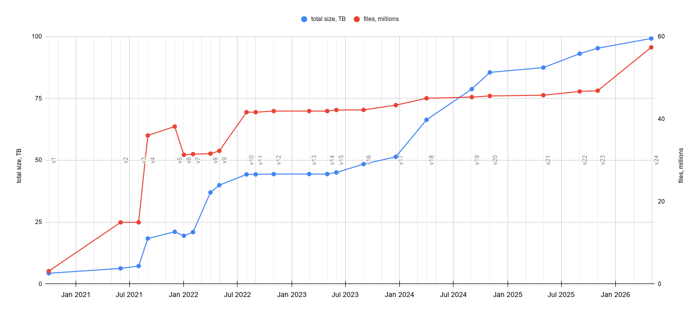

# Data release notes


Data hosted by IDC is ingested from several sources, including [The Cancer Imaging Archive (TCIA)](https://www.cancerimagingarchive.net/), [Genomics Data Commons (GDC)](https://gdc.cancer.gov/), [Clinical Proteomic Tumor Analysis Consortium (CPTAC)](https://gdc.cancer.gov/about-gdc/contributed-genomic-data-cancer-research/clinical-proteomic-tumor-analysis-consortium-cptac) and [Human Tumor Atlas Network (HTAN)](https://humantumoratlas.org/).

Please refer to the license and terms of use, which are defined in the `license_url` and `source_doi` or `source_url` of the IDC BigQuery [`dicom_all` table](https://console.cloud.google.com/bigquery?p=bigquery-public-data\&d=idc_current\&t=dicom_all\&page=table). You can filter the data by license type in the [IDC Portal](https://imaging.datacommons.cancer.gov/), or programmatically, as demonstrated in [this tutorial](https://github.com/ImagingDataCommons/IDC-Tutorials/blob/master/notebooks/getting_started/part2_searching_basics.ipynb).


## IDC releases summary view

##

<figure><figcaption></figcaption></figure>

## v25 - Oct 2026

| Text                     | Count |
| ------------------------ | ----: |
| New collections          |     3 |
| New analysis results     |     2 |
| Updated collections      |    66 |
| Updated analysis results |     1 |
| Clinical tables added    |    80 |
| Clinical tables removed  |     2 |

#### New Collections

| Collection         | Program   | Cancer Type                                    | Modality         | Patients | Series | Source                     |
| ------------------ | --------- | ---------------------------------------------- | ---------------- | -------: | -----: | -------------------------- |
| FDG-PET-CT-Lesions | Community | Lymphoma, Melanoma, Non-small Cell Lung Cancer | CT, PT, SEG      |      900 |  3,042 | The Cancer Imaging Archive |
| MRI-DIR            | Community | Head and Neck Squamous Cell Carcinoma          | CT, MR, RTSTRUCT |        9 |     61 | The Cancer Imaging Archive |
| QIN-SARCOMA        | QIN       | Sarcomas                                       | MR               |       15 |  2,168 | The Cancer Imaging Archive |

**FDG-PET-CT-Lesions** ([IDC Portal](https://portal.imaging.datacommons.cancer.gov/explore/filters/?collection_id=fdg_pet_ct_lesions) | [DOI 10.7937/gkr0-xv29](https://doi.org/10.7937/gkr0-xv29)) — 1,014 whole-body FDG-PET/CT studies from 900 patients acquired at University Hospital Tübingen (2014-2018): 501 studies of patients with malignant lymphoma, melanoma or non-small cell lung cancer, and 513 negative controls. All FDG-avid tumor lesions manually segmented on the PET images, provided as DICOM SEG. Used in the autoPET MICCAI 2022 challenge. IDC hosts the defaced images that TCIA released under CC BY 4.0 in version 2; the original, non-defaced images remain TCIA Restricted and are not included. Sourced as-is in DICOM from TCIA.

**MRI-DIR** ([IDC Portal](https://portal.imaging.datacommons.cancer.gov/explore/filters/?collection_id=mri_dir) | [DOI 10.7937/K9/TCIA.2018.3f08iejt](https://doi.org/10.7937/K9/TCIA.2018.3f08iejt)) — Two image sets built at MD Anderson to measure deformable image registration accuracy in MRI. A porcine phantom implanted with ten 0.35 mm gold markers was immobilized and compressed into four positions and imaged at each with CT and with T1- and T2-weighted MR; the markers resolve on CT but fall below the MR voxel size, so they give ground-truth landmarks without interfering with MR-to-MR registration. Alongside it, eight synthetic subjects derived from 28 head and neck squamous cell carcinoma patients scanned before, during and after radiotherapy — four synthetic pre-treatment images in each of T1 and T2 weighting, each carrying four synthetic post-treatment images and an RTSTRUCT contouring the parotid, submandibular and sublingual glands. 9 subjects, 25 studies, 61 series, 3,596 instances. The accompanying deformation vector fields stay on TCIA as a MATLAB package and are not part of the DICOM ingest. Sourced as-is in DICOM from TCIA.

**QIN-SARCOMA** ([IDC Portal](https://portal.imaging.datacommons.cancer.gov/explore/filters/?collection_id=qin_sarcoma) | [DOI 10.7937/K9/TCIA.2016.fXL9sESs](https://doi.org/10.7937/K9/TCIA.2016.fXL9sESs)) — Longitudinal DCE-MRI of 15 patients with soft-tissue sarcoma, acquired at Oregon Health & Science University to assess response to preoperative chemoradiation, with up to three imaging time points per patient. 38 studies, 2,168 MR series. Formerly limited-access; TCIA made the collection public in April 2026. Sourced as-is in DICOM from TCIA.

#### New Analysis Results

| Analysis Result    | Program    | Cancer Type                                                                                       | Modality | Subjects | Series | Source                |
| ------------------ | ---------- | ------------------------------------------------------------------------------------------------- | -------- | -------: | -----: | --------------------- |
| LIDC-annot-NLST501 | NCI Trials | Lung Cancer, Healthy Controls (non-cancer)                                                        | CT, SEG  |      501 |  2,028 | Median Technologies   |
| RCC-AID            | TCGA       | Clear Cell Renal Cell Carcinoma, Papillary Renal Cell Carcinoma, Chromophobe Renal Cell Carcinoma | SEG      |       91 |    129 | Community contributor |

**LIDC-annot-NLST501** ([IDC Portal](https://portal.imaging.datacommons.cancer.gov/explore/filters/?analysis_results_id=LIDC-annot-NLST501) | [DOI 10.7937/y2dx-e334](https://doi.org/10.7937/y2dx-e334)) — LIDC-IDRI-style annotations of lung nodules on 501 NLST chest CT scans, built and curated by Median Technologies. Each scan was read independently four times by 20 board-certified radiologists engaged through Ingedata, giving 2,004 DICOM Segmentations (501 × 4) that carry the 6,505 most suspicious lesions — 6,418 Nodule and 87 Mass segments — together with a whole-lung mask inferred with TotalSegmentator v2.4.0, for 8,509 segments in all. The reader is recorded in PersonIdentificationCodeSequence and the independent read database in InstitutionCodeSequence. The cohort is deliberately cancer-enriched: 152 of the 501 patients have histopathology-confirmed lung cancer and 349 do not, verified against IDC's `nlst_canc` clinical table. IDC hosts the DICOM portion — the segmentations plus 24 corrected CT series, published under new SeriesInstanceUIDs within the original NLST studies, which replace source series that had duplicate slices, several acquisitions in one series, or missing slices. The 501 source CT series are already in IDC as part of [NLST](https://doi.org/10.7937/tcia.hmq8-j677); the NIfTI masks and the accompanying CSV tables remain on TCIA. Sourced as-is in DICOM from TCIA.

**RCC-AID** ([IDC Portal](https://portal.imaging.datacommons.cancer.gov/explore/filters/?analysis_results_id=RCC-AID) | [DOI 10.5281/zenodo.22284133](https://doi.org/10.5281/zenodo.22284133)) — Voxel-level annotations of the kidney and of renal masses and cysts over the TCGA renal cell carcinoma collections: one DICOM Segmentation per annotated CT scan, 129 scans from 91 patients across TCGA-KIRC (85), TCGA-KIRP (26) and TCGA-KICH (18). Annotated with a model-initialised, human-corrected workflow and published in NIfTI as the RCC-AID dataset ([10.5281/zenodo.20719257](https://doi.org/10.5281/zenodo.20719257), CC BY 4.0) and described in [MELBA 2026](https://doi.org/10.59275/j.melba.2026-2dg2); converted to DICOM by IDC with dcmqi 1.5.7, coding the segmented structures as Kidney, Mass and Cyst per DICOM PS3.16 and referencing the exact source image instances each annotation applies to. Conversion performed by IDC.

**These are the archive's first LABELMAP segmentations.** As of v24 `seg_index` holds 172,908 BINARY and 17,238 FRACTIONAL series and no LABELMAP at all, so nothing downstream has been exercised against the type. A BINARY variant was generated in parallel and verified to decode identically, as a fallback if LABELMAP support proves insufficient.

#### Updated Collections

**JPEG 2000 whole-slide images corrected across 52 collections.** 40,660 slide microscopy instances — about 10% of the archive's 391,932 SM instances — are replaced to correct the DICOM attributes that tell a decoder how to interpret their JPEG 2000 pixel data. The symptom was colour corruption on affected slides, reported against OpenSlide in [openslide/openslide#772](https://github.com/openslide/openslide/issues/772).

Every replaced instance keeps its SOPInstanceUID, so no patient, study or series is added or removed and no derived dataset has to change: the SEG and ANN instances that reference these images continue to resolve. What changes is the metadata described below and, as for any replaced instance, the `crdc_instance_uuid`, which is reminted on ingestion.

**The pixel data is not re-encoded.** The encapsulated JPEG 2000 codestreams are carried over byte for byte — in the instances compared in full, the entire Pixel Data element, fragment boundaries included, has the same MD5 before and after. The images are not recompressed, and nothing is lost. What was wrong, and is now fixed, is the metadata that says how those bytes are to be read.

The correction reaches beyond the `YBR_ICT` images named in the issue title: of the 40,660 replaced instances, 38,732 use JPEG 2000 lossy (`1.2.840.10008.1.2.4.91`) and 1,928 JPEG 2000 lossless (`1.2.840.10008.1.2.4.90`). For the lossy instances, Photometric Interpretation (0028,0004) was wrong in both directions:

| v24 value | v25 value      | Instances |
| --------- | -------------- | --------: |
| `YBR_ICT` | `YBR_FULL_422` |    23,729 |
| `RGB`     | `YBR_ICT`      |    15,003 |

A decoder that trusts the attribute therefore applied a colour transform the codestream had not applied, or skipped one it had — which is the rendering behaviour the OpenSlide issue describes. These replacements also carry a second Contributing Equipment Sequence item recording the tool that made the edit as Modifying Equipment (DCM 109103).

The 1,928 JPEG 2000 lossless instances keep their Photometric Interpretation — 1,598 `YBR_RCT` and 330 `MONOCHROME2`, unchanged in both value and count between v24 and v25. In those compared in full, the only difference from the published instance lies in Data Set Trailing Padding (FFFC,FFFC), which carries a copy of the source Aperio TIFF directory: its compression tag moves from 33003 (JPEG 2000 YCbCr) to 33005 (JPEG 2000 RGB). Nothing a DICOM reader interprets changes for them.

A further 14,270 uncompressed ancillary images (thumbnail, label and overview) were restaged alongside them but proved byte-identical to what IDC already publishes; those are excluded from the manifests and are not re-ingested.

Object sizes move by a median of +0.0006%, in both directions and by under 1% in every case, and the metadata accounts for all of it: the added equipment item and the longer Photometric Interpretation value grow the header by 358 bytes, while a replacement whose published counterpart carried a Basic Offset Table drops it — 4 bytes per frame, 411,840 bytes on the 102,960-frame CATCH slide examined, which is exactly that slide's 411,482-byte net shrink.

| Collection              | SM instances replaced |
| ----------------------- | --------------------: |
| CGCI-BLGSP              |                 5,180 |
| NLST                    |                 3,766 |
| TCGA-LUAD               |                 2,414 |
| TCGA-COAD               |                 2,296 |
| TCGA-KIRC               |                 1,752 |
| TCGA-LUSC               |                 1,714 |
| HCMI-CMDC               |                 1,709 |
| TCGA-PRAD               |                 1,548 |
| TCGA-HNSC               |                 1,512 |
| RMS-Mutation-Prediction |                 1,484 |
| CGCI-HTMCP-DLBCL        |                 1,433 |
| TCGA-STAD               |                 1,380 |
| TCGA-GBM                |                 1,204 |
| CATCH                   |                 1,200 |
| CPTAC-COAD              |                 1,195 |
| TCGA-KIRP               |                 1,168 |
| TCGA-LGG                |                 1,121 |
| CGCI-HTMCP-CC           |                 1,010 |
| CPTAC-BRCA              |                   980 |
| TCGA-READ               |                   868 |
| CCDI-MCI                |                   679 |
| TCGA-TGCT               |                   672 |
| CPTAC-OV                |                   554 |
| TCGA-THYM               |                   468 |
| TCGA-PAAD               |                   391 |
| HTAN-TNP-SARDANA        |                   246 |
| TCGA-CESC               |                   243 |
| CGCI-HTMCP-LC           |                   231 |
| TCGA-UCEC               |                   217 |
| TCGA-LIHC               |                   204 |
| HTAN-VANDERBILT         |                   165 |
| TCGA-BRCA               |                   161 |
| TCGA-SARC               |                   160 |
| CDDP-EAGLE-1            |                   157 |
| ICDC-Glioma             |                   134 |
| TCGA-DLBC               |                   123 |
| TCGA-KICH               |                   106 |
| TCGA-BLCA               |                   103 |
| CPTAC-SAR               |                    93 |
| TCGA-SKCM               |                    93 |
| HTAN-OHSU               |                    90 |
| TCGA-ACC                |                    75 |
| TCGA-MESO               |                    72 |
| TCGA-ESCA               |                    68 |
| TCGA-OV                 |                    63 |
| TCGA-PCPG               |                    51 |
| CPTAC-UCEC              |                    27 |
| TCGA-UVM                |                    26 |
| CPTAC-LUAD              |                    21 |
| CPTAC-CM                |                    15 |
| TCGA-THCA               |                    14 |
| TCGA-CHOL               |                     4 |
| **52 collections**      |            **40,660** |

**HTAN presentation states re-encoded with a standard palette LUT.** All 324 Advanced Blending Presentation State instances in IDC, spread across 107 series in four HTAN collections, are replaced. The published instances encoded each channel's pseudo-color palette as a **segmented** Palette Color Lookup Table, which the presentation state IODs do not permit. They also declared 16 bits per entry while writing entries in the 0–255 range. Read as the standard defines it, a 16-bit entry of 255 is under 0.4% of full intensity, so a conformant viewer renders every channel near-black. The replacements carry the same palettes expanded to an ordinary 256-entry, 8-bit Palette Color Lookup Table.

Unlike the JPEG 2000 reconversion above, these replacements carry **new SOPInstanceUIDs and SeriesInstanceUIDs**: each of the 107 series is superseded by a new series in the same study, with the same number of instances. The slide microscopy images the presentation states reference keep their UIDs, so those references continue to resolve. A link or script that names a presentation state by its old UID will need the new one.

Each new instance was checked against the one it supersedes. For HTAN-WUSTL, HTAN-HMS and HTAN-OHSU the replacements are the published instances re-encoded: expanding the old segmented table reproduces the new 8-bit table entry for entry, and no other attribute differs apart from the two UIDs. The 19 HTAN-TNP-SARDANA replacements were instead regenerated from the collection's channel configuration, as the originals were. They reference the same 132 slide microscopy instances with the same blending inputs and VOI windows, and carry the same palettes. The exception is four channels of one instance, whose ramps are truncated rather than rounded, so some entries are one lower. They also drop ContentDate and ContentTime, which the presentation state IODs do not use.

| Collection        | PR series | PR instances replaced |
| ----------------- | --------: | --------------------: |
| HTAN-WUSTL        |        78 |                   234 |
| HTAN-HMS          |        15 |                    45 |
| HTAN-OHSU         |        13 |                    26 |
| HTAN-TNP-SARDANA  |         1 |                    19 |
| **4 collections** |   **107** |               **324** |

**Radiology added to ten TCIA collections.** TCIA published new versions of nine Cancer Moonshot Biobank collections and of Vestibular-Schwannoma-MC-RC, each adding radiology images. IDC ingests the added images as TCIA delivered them, in DICOM and without conversion: 246 patients, 3,512 series and 401,190 instances. The update is purely additive. No study, series or instance UID in it is already in IDC, in these collections or any other, and each collection's radiology in IDC now matches TCIA's CC BY 4.0 radiology download in patients, studies, series and images.

Of the 246 patients, 84 are new to IDC. Another 65 already had pathology in IDC and now gain radiology, and the remaining 97 gain further studies. CMB-OV gains its first MR series; its radiology in IDC was CT only.

Two parts of the TCIA releases are not included. The same TCIA versions add pathology slides to eight of the CMB collections, which are not part of this update. And seven of the CMB collections keep their images of the head in a separate download under the TCIA Restricted license, which IDC does not host.

| Collection                  | TCIA version | Patients with new series | Patients (delta) | Series (delta) | Instances (delta) | Modality       |
| --------------------------- | ------------ | -----------------------: | ---------------: | -------------: | ----------------: | -------------- |
| CMB-LCA                     | 10 → 12      |                       56 |               15 |          1,124 |           160,066 | CT, MR, PT, US |
| CMB-CRC                     | 9 → 11       |                       28 |               10 |            764 |            89,049 | CT, MR, US     |
| CMB-BRCA                    | 4 → 6        |                       27 |                8 |            546 |            73,375 | CT, MR, US     |
| CMB-MML                     | 9 → 11       |                       51 |                9 |            462 |            17,377 | CR, CT, MR, XA |
| CMB-OV                      | 3 → 4        |                        8 |                0 |            234 |            24,380 | CT, MR         |
| Vestibular-Schwannoma-MC-RC | 1 → 2        |                       60 |               36 |            133 |             8,016 | MR             |
| CMB-GEC                     | 7 → 9        |                        6 |                2 |            123 |            15,893 | CT             |
| CMB-PCA                     | 10 → 12      |                        8 |                3 |             73 |             6,068 | CT, MR         |
| CMB-MEL                     | 10 → 12      |                        1 |                0 |             50 |             6,923 | CT, PT, US     |
| CMB-AML                     | 7 → 9        |                        1 |                1 |              3 |                43 | CT             |
| **10 collections**          |              |                  **246** |           **84** |      **3,512** |       **401,190** |                |

**EA1141 corrected and completed.** TCIA published version 2 of [EA1141](https://doi.org/10.7937/2BAS-HR33) on 2026-05-19, correcting a malformed UID in the DICOM header and supplying images that version 1 had left out. IDC ingests the update as TCIA delivered it, in DICOM and without conversion: 196,328 staged instances over 251 patients, 400 studies and 1,045 series.

Unlike the ten collections above, this update is not additive. **447** of the staged instances are new to IDC — three new mammography series of one image each, plus 444 previously missing images in 403 existing series across 233 patients and 304 studies, exactly what TCIA's change log describes. A further **45,121** keep a SOPInstanceUID already published in v24 but change the bytes behind it, so they are replacements rather than additions. The remaining **150,760** are byte-identical to the files IDC already stores and need no action at all. No study, series or instance UID in the update appears in any IDC collection other than EA1141.

That three-way split is established by MD5, not inferred. Every staged object is named for a `crdc_instance_uuid`; 150,760 of them reuse the UUID IDC assigned in v24, and for all 150,760 the object's MD5 and size match `instance_hash` and `instance_size` in `idc_current.dicom_all`, with no mismatch anywhere on a reused UUID. The other 45,568 objects — the 45,121 replacements plus the 447 additions — carry freshly minted UUIDs. TCIA re-delivered whole series rather than only the files it corrected: all 1,045 staged series hold at least one changed or new instance, while 374 of them also carry unchanged files.

The correction itself reaches 45,114 instances (44,757 MR, 357 MG), whose `ReferencedStudySequence` gave the Referenced SOP Class UID as `1.2.840.100008.3.1.2.3.1` — a malformed UID carrying an extra digit — where it should read `1.2.840.10008.3.1.2.3.1`. 44,836 of those also move from Implicit to Explicit VR Little Endian; both are uncompressed, so no pixel data changes.

One change is not in TCIA's change log: seven mammography instances drop the word "EMPLOYEE" from StudyDescription, "MAMMO-DIGITAL SCREENING EMPLOYEE W/ TOMO" becoming "MAMMO-DIGITAL SCREENING W/ TOMO". These seven are the only replacements whose Referenced SOP Class UID was already correct, so between the two changes every one of the 45,121 is accounted for.

With the update applied, EA1141 in IDC matches TCIA's CC BY 4.0 download exactly.

| Collection | TCIA version | Instances added | Instances replaced | Series (total) | Instances (total) | Modality   |
| ---------- | ------------ | --------------: | -----------------: | -------------: | ----------------: | ---------- |
| EA1141     | 1 → 2        |             447 |             45,121 |         14,343 |           855,640 | CT, MG, MR |

**Every updated collection**, with what changed in `dicom_all`:

| Collection                      | Change                                                                                                 | Patients (delta) | Series (delta) | Instances (delta) | Modality                       | DOI                                                                |
| ------------------------------- | ------------------------------------------------------------------------------------------------------ | ---------------: | -------------: | ----------------: | ------------------------------ | ------------------------------------------------------------------ |
| BoneMarrowWSI-PediatricLeukemia | 7 series and 13 instances added                                                                        |               +1 |             +7 |               +13 | ANN, SM                        | [10.5281/zenodo.14933087](https://doi.org/10.5281/zenodo.14933087) |
| CATCH                           | 350 series and 350 instances added; 1,200 instances replaced, UIDs kept; adds ANN                      |                0 |           +350 |              +350 | ANN, SM                        | [10.5281/zenodo.18526942](https://doi.org/10.5281/zenodo.18526942) |
| CCDI-MCI                        | 679 instances replaced, UIDs kept                                                                      |                0 |              0 |                 0 | SM                             | [10.5281/zenodo.11099086](https://doi.org/10.5281/zenodo.11099086) |
| CDDP-EAGLE-1                    | 157 instances replaced, UIDs kept                                                                      |                0 |              0 |                 0 | SM                             | [10.5281/zenodo.17372206](https://doi.org/10.5281/zenodo.17372206) |
| CGCI-BLGSP                      | 5,180 instances replaced, UIDs kept                                                                    |                0 |              0 |                 0 | SM                             | [10.5281/zenodo.17381396](https://doi.org/10.5281/zenodo.17381396) |
| CGCI-HTMCP-CC                   | 1,010 instances replaced, UIDs kept                                                                    |                0 |              0 |                 0 | SM                             | [10.5281/zenodo.17381404](https://doi.org/10.5281/zenodo.17381404) |
| CGCI-HTMCP-DLBCL                | 1,433 instances replaced, UIDs kept                                                                    |                0 |              0 |                 0 | SM                             | [10.5281/zenodo.17381412](https://doi.org/10.5281/zenodo.17381412) |
| CGCI-HTMCP-LC                   | 231 instances replaced, UIDs kept                                                                      |                0 |              0 |                 0 | SM                             | [10.5281/zenodo.17381428](https://doi.org/10.5281/zenodo.17381428) |
| CMB-AML                         | 3 series and 43 instances added                                                                        |               +1 |             +3 |               +43 | CT, MR, SM, XA                 | [10.7937/pcte-6m66](https://doi.org/10.7937/pcte-6m66)             |
| CMB-BRCA                        | 546 series and 73,375 instances added                                                                  |               +8 |           +546 |           +73,375 | CT, MG, MR, PT, SM, US         | [10.7937/dx22-8j71](https://doi.org/10.7937/dx22-8j71)             |
| CMB-CRC                         | 764 series and 89,049 instances added                                                                  |              +10 |           +764 |           +89,049 | CT, DX, MR, NM, PT, SM, US, XA | [10.7937/djg7-gz87](https://doi.org/10.7937/djg7-gz87)             |
| CMB-GEC                         | 123 series and 15,893 instances added                                                                  |               +2 |           +123 |           +15,893 | CT, MR, PT, SM                 | [10.7937/e7kh-r486](https://doi.org/10.7937/e7kh-r486)             |
| CMB-LCA                         | 1,124 series and 160,066 instances added                                                               |              +15 |         +1,124 |          +160,066 | CT, DX, MR, NM, PT, SM, US     | [10.7937/3cx3-s132](https://doi.org/10.7937/3cx3-s132)             |
| CMB-MEL                         | 50 series and 6,923 instances added                                                                    |                0 |            +50 |            +6,923 | CT, MR, PT, SM, US             | [10.7937/gwsp-wh72](https://doi.org/10.7937/gwsp-wh72)             |
| CMB-MML                         | 462 series and 17,377 instances added                                                                  |               +9 |           +462 |           +17,377 | CR, CT, DX, MR, PT, SM, XA     | [10.7937/szkb-sw39](https://doi.org/10.7937/szkb-sw39)             |
| CMB-OV                          | 234 series and 24,380 instances added; adds MR                                                         |                0 |           +234 |           +24,380 | CT, MR, SM                     | [10.7937/4nx6-e061](https://doi.org/10.7937/4nx6-e061)             |
| CMB-PCA                         | 73 series and 6,068 instances added                                                                    |               +3 |            +73 |            +6,068 | CT, DX, MR, NM, PT, RF, SM     | [10.7937/25t7-6y12](https://doi.org/10.7937/25t7-6y12)             |
| CPTAC-BRCA                      | 980 instances replaced, UIDs kept                                                                      |                0 |              0 |                 0 | SM                             | [10.5281/zenodo.12666759](https://doi.org/10.5281/zenodo.12666759) |
| CPTAC-CM                        | 15 instances replaced, UIDs kept                                                                       |                0 |              0 |                 0 | CT, MR, PT, SM                 | [10.5281/zenodo.12666775](https://doi.org/10.5281/zenodo.12666775) |
| CPTAC-COAD                      | 1,195 instances replaced, UIDs kept                                                                    |                0 |              0 |                 0 | SM                             | [10.5281/zenodo.12666784](https://doi.org/10.5281/zenodo.12666784) |
| CPTAC-LUAD                      | 21 instances replaced, UIDs kept                                                                       |                0 |              0 |                 0 | CT, MR, PT, SM                 | [10.5281/zenodo.12666813](https://doi.org/10.5281/zenodo.12666813) |
| CPTAC-OV                        | 554 instances replaced, UIDs kept                                                                      |                0 |              0 |                 0 | SM                             | [10.5281/zenodo.12666842](https://doi.org/10.5281/zenodo.12666842) |
| CPTAC-SAR                       | 93 instances replaced, UIDs kept                                                                       |                0 |              0 |                 0 | CT, MR, PT, SM                 | [10.5281/zenodo.12666862](https://doi.org/10.5281/zenodo.12666862) |
| CPTAC-UCEC                      | 27 instances replaced, UIDs kept                                                                       |                0 |              0 |                 0 | CT, MR, PT, SM, US             | [10.5281/zenodo.12666865](https://doi.org/10.5281/zenodo.12666865) |
| EA1141                          | 3 series and 447 instances added; 45,121 instances replaced, UIDs kept                                 |                0 |             +3 |              +447 | CT, MG, MR                     | [10.7937/2bas-hr33](https://doi.org/10.7937/2bas-hr33)             |
| HCMI-CMDC                       | 1,709 instances replaced, UIDs kept                                                                    |                0 |              0 |                 0 | SM                             | [10.5281/zenodo.17381441](https://doi.org/10.5281/zenodo.17381441) |
| HTAN-HMS                        | 15 series and 45 instances added; 15 series and 45 instances removed                                   |                0 |              0 |                 0 | PR, SM                         | [10.5281/zenodo.12666872](https://doi.org/10.5281/zenodo.12666872) |
| HTAN-OHSU                       | 13 series and 26 instances added; 13 series and 26 instances removed; 90 instances replaced, UIDs kept |                0 |              0 |                 0 | PR, SM                         | [10.5281/zenodo.12689950](https://doi.org/10.5281/zenodo.12689950) |
| HTAN-TNP-SARDANA                | 1 series and 19 instances added; 1 series and 19 instances removed; 246 instances replaced, UIDs kept  |                0 |              0 |                 0 | PR, SM                         | [10.5281/zenodo.18488943](https://doi.org/10.5281/zenodo.18488943) |
| HTAN-VANDERBILT                 | 165 instances replaced, UIDs kept                                                                      |                0 |              0 |                 0 | SM                             | [10.5281/zenodo.12690006](https://doi.org/10.5281/zenodo.12690006) |
| HTAN-WUSTL                      | 78 series and 234 instances added; 78 series and 234 instances removed                                 |                0 |              0 |                 0 | PR, SM                         | [10.5281/zenodo.12689993](https://doi.org/10.5281/zenodo.12689993) |
| ICDC-Glioma                     | 134 instances replaced, UIDs kept                                                                      |                0 |              0 |                 0 | MR, SM                         | [10.5281/zenodo.12690000](https://doi.org/10.5281/zenodo.12690000) |
| NLST                            | 3,766 instances replaced, UIDs kept                                                                    |                0 |              0 |                 0 | CT, SM                         | [10.5281/zenodo.12689650](https://doi.org/10.5281/zenodo.12689650) |
| RMS-Mutation-Prediction         | 1,484 instances replaced, UIDs kept                                                                    |                0 |              0 |                 0 | SM                             | [10.5281/zenodo.8225131](https://doi.org/10.5281/zenodo.8225131)   |
| TCGA-ACC                        | 75 instances replaced, UIDs kept                                                                       |                0 |              0 |                 0 | SM                             | [10.5281/zenodo.12690035](https://doi.org/10.5281/zenodo.12690035) |
| TCGA-BLCA                       | 103 instances replaced, UIDs kept                                                                      |                0 |              0 |                 0 | CR, CT, DX, MR, PT, SM         | [10.5281/zenodo.12690045](https://doi.org/10.5281/zenodo.12690045) |
| TCGA-BRCA                       | 161 instances replaced, UIDs kept                                                                      |                0 |              0 |                 0 | MG, MR, SM                     | [10.5281/zenodo.12689962](https://doi.org/10.5281/zenodo.12689962) |
| TCGA-CESC                       | 243 instances replaced, UIDs kept                                                                      |                0 |              0 |                 0 | MR, SM                         | [10.5281/zenodo.12689956](https://doi.org/10.5281/zenodo.12689956) |
| TCGA-CHOL                       | 4 instances replaced, UIDs kept                                                                        |                0 |              0 |                 0 | SM                             | [10.5281/zenodo.12689990](https://doi.org/10.5281/zenodo.12689990) |
| TCGA-COAD                       | 2,296 instances replaced, UIDs kept                                                                    |                0 |              0 |                 0 | CT, OT, SM                     | [10.5281/zenodo.12689970](https://doi.org/10.5281/zenodo.12689970) |
| TCGA-DLBC                       | 123 instances replaced, UIDs kept                                                                      |                0 |              0 |                 0 | SM                             | [10.5281/zenodo.12690047](https://doi.org/10.5281/zenodo.12690047) |
| TCGA-ESCA                       | 68 instances replaced, UIDs kept                                                                       |                0 |              0 |                 0 | CT, SM                         | [10.5281/zenodo.12690012](https://doi.org/10.5281/zenodo.12690012) |
| TCGA-GBM                        | 1,204 instances replaced, UIDs kept                                                                    |                0 |              0 |                 0 | SM                             | [10.5281/zenodo.12690010](https://doi.org/10.5281/zenodo.12690010) |
| TCGA-HNSC                       | 1,512 instances replaced, UIDs kept                                                                    |                0 |              0 |                 0 | SM                             | [10.5281/zenodo.12690033](https://doi.org/10.5281/zenodo.12690033) |
| TCGA-KICH                       | 106 instances replaced, UIDs kept                                                                      |                0 |              0 |                 0 | CT, MR, SM                     | [10.5281/zenodo.12690004](https://doi.org/10.5281/zenodo.12690004) |
| TCGA-KIRC                       | 1,752 instances replaced, UIDs kept                                                                    |                0 |              0 |                 0 | CR, CT, MR, SM                 | [10.5281/zenodo.12689952](https://doi.org/10.5281/zenodo.12689952) |
| TCGA-KIRP                       | 1,168 instances replaced, UIDs kept                                                                    |                0 |              0 |                 0 | CT, MR, PT, SM                 | [10.5281/zenodo.12689919](https://doi.org/10.5281/zenodo.12689919) |
| TCGA-LGG                        | 1,121 instances replaced, UIDs kept                                                                    |                0 |              0 |                 0 | SM                             | [10.5281/zenodo.12689948](https://doi.org/10.5281/zenodo.12689948) |
| TCGA-LIHC                       | 204 instances replaced, UIDs kept                                                                      |                0 |              0 |                 0 | CT, MR, PT, SM                 | [10.5281/zenodo.12690002](https://doi.org/10.5281/zenodo.12690002) |
| TCGA-LUAD                       | 2,414 instances replaced, UIDs kept                                                                    |                0 |              0 |                 0 | CT, NM, PT, SM                 | [10.5281/zenodo.12689915](https://doi.org/10.5281/zenodo.12689915) |
| TCGA-LUSC                       | 1,714 instances replaced, UIDs kept                                                                    |                0 |              0 |                 0 | CT, NM, PT, SM                 | [10.5281/zenodo.12690008](https://doi.org/10.5281/zenodo.12690008) |
| TCGA-MESO                       | 72 instances replaced, UIDs kept                                                                       |                0 |              0 |                 0 | SM                             | [10.5281/zenodo.12689966](https://doi.org/10.5281/zenodo.12689966) |
| TCGA-OV                         | 63 instances replaced, UIDs kept                                                                       |                0 |              0 |                 0 | CT, MR, OT, SM                 | [10.5281/zenodo.12689954](https://doi.org/10.5281/zenodo.12689954) |
| TCGA-PAAD                       | 391 instances replaced, UIDs kept                                                                      |                0 |              0 |                 0 | SM                             | [10.5281/zenodo.12689972](https://doi.org/10.5281/zenodo.12689972) |
| TCGA-PCPG                       | 51 instances replaced, UIDs kept                                                                       |                0 |              0 |                 0 | SM                             | [10.5281/zenodo.12689964](https://doi.org/10.5281/zenodo.12689964) |
| TCGA-PRAD                       | 1,548 instances replaced, UIDs kept                                                                    |                0 |              0 |                 0 | CT, MR, PT, SM                 | [10.5281/zenodo.12689935](https://doi.org/10.5281/zenodo.12689935) |
| TCGA-READ                       | 868 instances replaced, UIDs kept                                                                      |                0 |              0 |                 0 | CT, MR, SM                     | [10.5281/zenodo.12689998](https://doi.org/10.5281/zenodo.12689998) |
| TCGA-SARC                       | 160 instances replaced, UIDs kept                                                                      |                0 |              0 |                 0 | CT, MR, SM                     | [10.5281/zenodo.12689917](https://doi.org/10.5281/zenodo.12689917) |
| TCGA-SKCM                       | 93 instances replaced, UIDs kept                                                                       |                0 |              0 |                 0 | SM                             | [10.5281/zenodo.12690039](https://doi.org/10.5281/zenodo.12690039) |
| TCGA-STAD                       | 1,380 instances replaced, UIDs kept                                                                    |                0 |              0 |                 0 | CT, SM                         | [10.5281/zenodo.12690037](https://doi.org/10.5281/zenodo.12690037) |
| TCGA-TGCT                       | 672 instances replaced, UIDs kept                                                                      |                0 |              0 |                 0 | SM                             | [10.5281/zenodo.12689995](https://doi.org/10.5281/zenodo.12689995) |
| TCGA-THCA                       | 14 instances replaced, UIDs kept                                                                       |                0 |              0 |                 0 | CT, PT, SM                     | [10.5281/zenodo.12689958](https://doi.org/10.5281/zenodo.12689958) |
| TCGA-THYM                       | 468 instances replaced, UIDs kept                                                                      |                0 |              0 |                 0 | SM                             | [10.5281/zenodo.12689913](https://doi.org/10.5281/zenodo.12689913) |
| TCGA-UCEC                       | 217 instances replaced, UIDs kept                                                                      |                0 |              0 |                 0 | CR, CT, MR, PT, SM             | [10.5281/zenodo.12689968](https://doi.org/10.5281/zenodo.12689968) |
| TCGA-UVM                        | 26 instances replaced, UIDs kept                                                                       |                0 |              0 |                 0 | SM                             | [10.5281/zenodo.12690041](https://doi.org/10.5281/zenodo.12690041) |
| Vestibular-Schwannoma-MC-RC     | 133 series and 8,016 instances added                                                                   |              +36 |           +133 |            +8,016 | MR                             | [10.7937/hrzh-2n82](https://doi.org/10.7937/hrzh-2n82)             |

#### Updated Analysis Results

| Analysis Result             | Change                             | Subjects (delta) | Series (delta) | Instances (delta) | Modality | DOI                                                                |
| --------------------------- | ---------------------------------- | ---------------: | -------------: | ----------------: | -------- | ------------------------------------------------------------------ |
| Pan-Cancer-Nuclei-Seg-DICOM | 20 series and 54 instances removed |                0 |            -20 |               -54 | ANN, SEG | [10.5281/zenodo.11099004](https://doi.org/10.5281/zenodo.11099004) |

**Pan-Cancer-Nuclei-Seg-DICOM** ([IDC Portal](https://portal.imaging.datacommons.cancer.gov/explore/filters/?analysis_results_id=Pan-Cancer-Nuclei-Seg-DICOM) | [DOI 10.5281/zenodo.11099004](https://doi.org/10.5281/zenodo.11099004)) — Deletion only; no new data. Ten TCGA-LUAD whole-slide images each carried two visually identical ANN series and two visually identical SEG series. One complete series of each pair is removed — 20 series, 54 instances in total — leaving one copy of every annotation in place. No series is partially deleted and no other collection in the analysis result is affected.

#### Clinical Tables

_Tables in the `idc_v25_clinical` BigQuery dataset compared with `idc_v24_clinical`. A table is updated when its content changed._

| Collection or Analysis Result | Added                                                                                                                                                                                                                   | Updated | Removed                                                                    |
| ----------------------------- | ----------------------------------------------------------------------------------------------------------------------------------------------------------------------------------------------------------------------- | ------- | -------------------------------------------------------------------------- |
| CPTAC-BRCA                    | `cptac_brca_clinical`                                                                                                                                                                                                   | —       | —                                                                          |
| CPTAC-CCRCC                   | `cptac_ccrcc_clinical`                                                                                                                                                                                                  | —       | —                                                                          |
| CPTAC-COAD                    | `cptac_coad_clinical`                                                                                                                                                                                                   | —       | —                                                                          |
| CPTAC-GBM                     | `cptac_gbm_clinical`                                                                                                                                                                                                    | —       | —                                                                          |
| CPTAC-HNSCC                   | `cptac_hnscc_clinical`                                                                                                                                                                                                  | —       | —                                                                          |
| CPTAC-LSCC                    | `cptac_lscc_clinical`                                                                                                                                                                                                   | —       | —                                                                          |
| CPTAC-LUAD                    | `cptac_luad_clinical`                                                                                                                                                                                                   | —       | —                                                                          |
| CPTAC-OV                      | `cptac_ov_clinical`                                                                                                                                                                                                     | —       | —                                                                          |
| CPTAC-PDA                     | `cptac_pda_clinical`                                                                                                                                                                                                    | —       | —                                                                          |
| CPTAC-UCEC                    | `cptac_ucec_clinical`                                                                                                                                                                                                   | —       | —                                                                          |
| FDG-PET-CT-Lesions            | `fdg_pet_ct_lesions_clinical`                                                                                                                                                                                           | —       | —                                                                          |
| HTAN-HMS                      | `htan_hms_demographics`, `htan_hms_diagnosis`, `htan_hms_exposure`, `htan_hms_familyhistory`, `htan_hms_followup`, `htan_hms_moleculartest`, `htan_hms_therapy`                                                         | —       | —                                                                          |
| HTAN-OHSU                     | `htan_ohsu_demographics`, `htan_ohsu_diagnosis`, `htan_ohsu_exposure`, `htan_ohsu_familyhistory`, `htan_ohsu_followup`, `htan_ohsu_moleculartest`, `htan_ohsu_therapy`                                                  | —       | —                                                                          |
| HTAN-TNP-SARDANA              | `htan_tnp_sardana_demographics`, `htan_tnp_sardana_diagnosis`, `htan_tnp_sardana_exposure`, `htan_tnp_sardana_familyhistory`, `htan_tnp_sardana_followup`, `htan_tnp_sardana_moleculartest`, `htan_tnp_sardana_therapy` | —       | —                                                                          |
| HTAN-VANDERBILT               | `htan_vanderbilt_demographics`, `htan_vanderbilt_diagnosis`, `htan_vanderbilt_exposure`, `htan_vanderbilt_familyhistory`, `htan_vanderbilt_followup`, `htan_vanderbilt_moleculartest`, `htan_vanderbilt_therapy`        | —       | —                                                                          |
| HTAN-WUSTL                    | `htan_wustl_demographics`, `htan_wustl_diagnosis`, `htan_wustl_exposure`, `htan_wustl_familyhistory`, `htan_wustl_followup`, `htan_wustl_therapy`                                                                       | —       | —                                                                          |
| LDCT-and-Projection-data      | `ldct_and_projection_data_abdomen_v11`, `ldct_and_projection_data_chest_v11`, `ldct_and_projection_data_head_v11`                                                                                                       | —       | `ldct_and_projection_data_abdomen_v9`, `ldct_and_projection_data_chest_v9` |
| TCGA-ACC                      | `tcga_acc_clinical`                                                                                                                                                                                                     | —       | —                                                                          |
| TCGA-BLCA                     | `tcga_blca_clinical`                                                                                                                                                                                                    | —       | —                                                                          |
| TCGA-BRCA                     | `tcga_brca_clinical`                                                                                                                                                                                                    | —       | —                                                                          |
| TCGA-CESC                     | `tcga_cesc_clinical`                                                                                                                                                                                                    | —       | —                                                                          |
| TCGA-CHOL                     | `tcga_chol_clinical`                                                                                                                                                                                                    | —       | —                                                                          |
| TCGA-COAD                     | `tcga_coad_clinical`                                                                                                                                                                                                    | —       | —                                                                          |
| TCGA-DLBC                     | `tcga_dlbc_clinical`                                                                                                                                                                                                    | —       | —                                                                          |
| TCGA-ESCA                     | `tcga_esca_clinical`                                                                                                                                                                                                    | —       | —                                                                          |
| TCGA-GBM                      | `tcga_gbm_clinical`                                                                                                                                                                                                     | —       | —                                                                          |
| TCGA-HNSC                     | `tcga_hnsc_clinical`                                                                                                                                                                                                    | —       | —                                                                          |
| TCGA-KICH                     | `tcga_kich_clinical`                                                                                                                                                                                                    | —       | —                                                                          |
| TCGA-KIRC                     | `tcga_kirc_clinical`                                                                                                                                                                                                    | —       | —                                                                          |
| TCGA-KIRP                     | `tcga_kirp_clinical`                                                                                                                                                                                                    | —       | —                                                                          |
| TCGA-LGG                      | `tcga_lgg_clinical`                                                                                                                                                                                                     | —       | —                                                                          |
| TCGA-LIHC                     | `tcga_lihc_clinical`                                                                                                                                                                                                    | —       | —                                                                          |
| TCGA-LUAD                     | `tcga_luad_clinical`                                                                                                                                                                                                    | —       | —                                                                          |
| TCGA-LUSC                     | `tcga_lusc_clinical`                                                                                                                                                                                                    | —       | —                                                                          |
| TCGA-MESO                     | `tcga_meso_clinical`                                                                                                                                                                                                    | —       | —                                                                          |
| TCGA-OV                       | `tcga_ov_clinical`                                                                                                                                                                                                      | —       | —                                                                          |
| TCGA-PAAD                     | `tcga_paad_clinical`                                                                                                                                                                                                    | —       | —                                                                          |
| TCGA-PCPG                     | `tcga_pcpg_clinical`                                                                                                                                                                                                    | —       | —                                                                          |
| TCGA-PRAD                     | `tcga_prad_clinical`                                                                                                                                                                                                    | —       | —                                                                          |
| TCGA-READ                     | `tcga_read_clinical`                                                                                                                                                                                                    | —       | —                                                                          |
| TCGA-SARC                     | `tcga_sarc_clinical`                                                                                                                                                                                                    | —       | —                                                                          |
| TCGA-SKCM                     | `tcga_skcm_clinical`                                                                                                                                                                                                    | —       | —                                                                          |
| TCGA-STAD                     | `tcga_stad_clinical`                                                                                                                                                                                                    | —       | —                                                                          |
| TCGA-TGCT                     | `tcga_tgct_clinical`                                                                                                                                                                                                    | —       | —                                                                          |
| TCGA-THCA                     | `tcga_thca_clinical`                                                                                                                                                                                                    | —       | —                                                                          |
| TCGA-THYM                     | `tcga_thym_clinical`                                                                                                                                                                                                    | —       | —                                                                          |
| TCGA-UCEC                     | `tcga_ucec_clinical`                                                                                                                                                                                                    | —       | —                                                                          |
| TCGA-UCS                      | `tcga_ucs_clinical`                                                                                                                                                                                                     | —       | —                                                                          |
| TCGA-UVM                      | `tcga_uvm_clinical`                                                                                                                                                                                                     | —       | —                                                                          |

## V24 - May 2026

### New Collections

| Collection                  | Program   | Cancer Type                          | Modality                          | Patients | Series | Source            |
| --------------------------- | --------- | ------------------------------------ | --------------------------------- | -------- | ------ | ----------------- |
| CDDP-EAGLE-1                | NIH       | Lung Adenocarcinoma                  | SM                                | 49       | 49     | GDC               |
| CGCI-BLGSP                  | CGCI      | Burkitt Lymphoma                     | SM                                | 388      | 1,933  | GDC               |
| CGCI-HTMCP-CC               | CGCI      | Cervical Squamous Cell Carcinoma     | SM                                | 211      | 525    | GDC               |
| CGCI-HTMCP-DLBCL            | CGCI      | Diffuse Large B-Cell Lymphoma        | SM                                | 43       | 496    | GDC               |
| CGCI-HTMCP-LC               | CGCI      | Non-Small Cell Carcinoma             | SM                                | 27       | 84     | GDC               |
| HCMI-CMDC                   | HCMI      | Various (pan-cancer)                 | SM                                | 382      | 810    | GDC               |
| PDXNet                      | NIH       | Various (pan-cancer PDX)             | SM                                | 919      | 919    | PDXNet Consortium |
| UW-CIRP-Mouse-PET-CT-NSCLC  | NIH       | Lung Squamous Cell Carcinoma         | PT, CT, RTSTRUCT                  | 14       | 75     | UW Co-CIRP        |
| HTAN-TNP-SARDANA            | HTAN      | Colon Mucinous Adenocarcinoma        | SM, PR                            | 1        | 3      | HTAN/Synapse      |
| CPTAC-STAD                  | CPTAC     | Stomach Adenocarcinoma               | CT, US                            | 20       | 99     | TCIA              |
| CATCH                       | Community | Canine cutaneous tumors (7 subtypes) | SM                                | 282      | 350    | TCIA              |
| LDCT-and-Projection-data    | Community | Lung Cancer                          | CT                                | 200      | 698    | TCIA              |
| PSMA-PET-CT-Lesions         | Community | Prostate Cancer                      | CT, PT, SEG                       | 378      | 1,791  | TCIA              |
| Spinal-Multiple-Myeloma-SEG | Community | Multiple Myeloma                     | CT, SEG                           | 67       | 720    | TCIA              |
| EAY131                      | NCTN      | Pan-cancer (46 types)                | CT, MR, PT, RTSTRUCT, SEG, NM, XA | 2,813    | 30,293 | TCIA              |

**CDDP-EAGLE-1** ([IDC Portal](https://portal.imaging.datacommons.cancer.gov/explore/filters/?collection_id=cddp_eagle_1) | [DOI 10.5281/zenodo.17372206](https://doi.org/10.5281/zenodo.17372206)) — 49 H\&E-stained frozen section whole slide images of primary lung adenocarcinoma from the EAGLE population-based case-control study (Lombardy, Italy). Converted from GDC Aperio SVS to DICOM SM.

**CGCI-BLGSP** ([IDC Portal](https://portal.imaging.datacommons.cancer.gov/explore/filters/?collection_id=cgci_blgsp) | [DOI 10.5281/zenodo.17381396](https://doi.org/10.5281/zenodo.17381396)) — 1,933 whole slide images from 388 subjects in the Burkitt Lymphoma Genome Sequencing Project. Includes H\&E and immunohistochemistry stains (BCL2, BCL6, CD10, Ki-67, CD20, CD3, CD5, CD79a), EBER in situ hybridization, and Wright-Giemsa. Both FFPE and frozen sections. Converted from GDC Aperio SVS to DICOM SM.

**CGCI-HTMCP-CC** ([IDC Portal](https://portal.imaging.datacommons.cancer.gov/explore/filters/?collection_id=cgci_htmcp_cc) | [DOI 10.5281/zenodo.17381404](https://doi.org/10.5281/zenodo.17381404)) — 525 whole slide images from 211 subjects in the HIV+ Tumor Molecular Characterization Project - Cervical Cancer, part of CGCI. Includes H\&E and p16 stains for most subjects, plus additional IHC markers (BER-EP4, MOC31, P40, P63, CEA, ER, PR, VIM, TP53, CD56, CHR, SYN) for subsets. Converted from GDC Aperio SVS to DICOM SM.

**CGCI-HTMCP-DLBCL** ([IDC Portal](https://portal.imaging.datacommons.cancer.gov/explore/filters/?collection_id=cgci_htmcp_dlbcl) | [DOI 10.5281/zenodo.17381412](https://doi.org/10.5281/zenodo.17381412)) — 496 whole slide images from 43 subjects in the HIV+ Tumor Molecular Characterization Project - Diffuse Large B-Cell Lymphoma, part of CGCI. Includes H\&E and IHC/ISH stains (BCL2, BCL6, CD10, CD20, CD3, CD79a, EBER, Ki-67, MUM1, TP53) for most subjects, plus INT and CD138 for subsets. Converted from GDC Aperio SVS to DICOM SM.

**CGCI-HTMCP-LC** ([IDC Portal](https://portal.imaging.datacommons.cancer.gov/explore/filters/?collection_id=cgci_htmcp_lc) | [DOI 10.5281/zenodo.17381428](https://doi.org/10.5281/zenodo.17381428)) — 84 whole slide images from 27 subjects in the HIV+ Tumor Molecular Characterization Project - Lung Cancer, part of CGCI. Includes H\&E, P40, and TTF1 stains for most subjects, plus CHR, SYN, and P16 for subsets. Converted from GDC Aperio SVS to DICOM SM.

**HCMI-CMDC** ([IDC Portal](https://portal.imaging.datacommons.cancer.gov/explore/filters/?collection_id=hcmi_cmdc) | [DOI 10.5281/zenodo.17381441](https://doi.org/10.5281/zenodo.17381441)) — 810 H\&E-stained whole slide images from 382 subjects in the Human Cancer Models Initiative Cancer Model Development Center. Pan-cancer collection spanning 20+ cancer types (colorectal, pancreatic, esophageal, breast, brain, melanoma, lung, and others) with both FFPE and frozen tumor and normal sections. Converted from GDC Aperio SVS to DICOM SM.

**PDXNet** ([IDC Portal](https://portal.imaging.datacommons.cancer.gov/explore/filters/?collection_id=pdxnet) | [DOI 10.5281/zenodo.16967600](https://doi.org/10.5281/zenodo.16967600)) — A pan-cancer repository of >1,000 patient-derived xenograft (PDX) and paired parental tumor H\&E whole slide images from the NCI PDXNet Consortium. Covers 29+ cancer types across 22 anatomic sites, with associated genomic, clinical, and pathologic annotation data. Contributed by BCM, Huntsman, MDACC, Wistar, WUSTL, and JAX. Converted from TIFF/SVS to DICOM SM.

**UW-CIRP-Mouse-PET-CT-NSCLC** ([IDC Portal](https://portal.imaging.datacommons.cancer.gov/explore/filters/?collection_id=uw_cirp_mouse_pet_ct_nsclc) | [DOI 10.5281/zenodo.17257735](https://doi.org/10.5281/zenodo.17257735)) — 18F-FDG PET/CT imaging of 14 genetically-engineered mouse models of lung squamous cell carcinoma from the NCI Co-CIRP program. 25 imaging sessions with 75 series (25 PT, 25 CT, 25 RTSTRUCT segmentations) on Siemens Inveon PET/CT. 11 animals imaged pre- and post-therapy (anti-PD-L1 + CXCR2 antagonist), 3 baseline-only.

**HTAN-TNP-SARDANA** ([IDC Portal](https://portal.imaging.datacommons.cancer.gov/explore/filters/?collection_id=htan_tnp_sardana) | [DOI 10.5281/zenodo.18488943](https://doi.org/10.5281/zenodo.18488943)) — CyCIF and H\&E whole slide images of a single colorectal cancer specimen from the HTAN SARDANA Trans-Network Project. 265 DICOM instances across 3 series: 240 CyCIF SM, 6 H\&E SM, and 19 presentation state (PR) instances. \~20 CyCIF markers targeting immune, epithelial, stromal, and proliferation cell populations.

**CPTAC-STAD** ([IDC Portal](https://portal.imaging.datacommons.cancer.gov/explore/filters/?collection_id=cptac_stad) | [DOI 10.7937/jw9a-8k71](https://doi.org/10.7937/jw9a-8k71)) — 99 radiology series (98 CT, 1 US) from 20 patients in the Clinical Proteomic Tumor Analysis Consortium Stomach Adenocarcinoma cohort. Images acquired as standard-of-care radiology (predominantly abdominal/abdominopelvic CT) prior to pathological diagnosis, made publicly available by TCIA. Sourced as-is in DICOM from TCIA.

**CATCH** ([IDC Portal](https://portal.imaging.datacommons.cancer.gov/explore/filters/?collection_id=catch) | [DOI 10.5281/zenodo.18526942](https://doi.org/10.5281/zenodo.18526942)) — 350 H\&E-stained whole slide images of seven canine cutaneous tumor subtypes (melanoma, mast cell tumor, squamous cell carcinoma, peripheral nerve sheath tumor, trichoblastoma, histiocytoma, plasmacytoma) from 282 patients. Includes 12,424 polygon annotations for 13 histologic classes. Original Aperio SVS images from TCIA converted to DICOM SM.

**LDCT-and-Projection-data** ([IDC Portal](https://portal.imaging.datacommons.cancer.gov/explore/filters/?collection_id=ldct_and_projection_data) | [DOI 10.7937/9npb-2637](https://doi.org/10.7937/9npb-2637)) — Low-dose CT images and projection data from 200 patients at Mayo Clinic, including non-contrast head CT, low-dose chest CT for pulmonary nodule screening, and contrast-enhanced abdominal CT. CT projection data provided in the open DICOM-CT-PD format. Sourced as-is in DICOM from TCIA.

**PSMA-PET-CT-Lesions** ([IDC Portal](https://portal.imaging.datacommons.cancer.gov/explore/filters/?collection_id=psma_pet_ct_lesions) | [DOI 10.7937/r7ep-3x37](https://doi.org/10.7937/r7ep-3x37)) — 597 whole-body PSMA-PET/CT studies from 378 male patients with suspected or diagnosed prostate carcinoma, acquired at LMU University Hospital Munich (2014-2022). All PSMA-avid tumor lesions manually segmented on PET images in 3D. Includes CT, PET, and DICOM SEG segmentation masks. Used in the autoPET III and IV Grand Challenges. Sourced as-is in DICOM from TCIA.

**Spinal-Multiple-Myeloma-SEG** ([IDC Portal](https://portal.imaging.datacommons.cancer.gov/explore/filters/?collection_id=spinal_multiple_myeloma_seg) | [DOI 10.7937/k4qv-hh78](https://doi.org/10.7937/k4qv-hh78)) — Dual-energy low-dose CT scans from 67 patients with multiple myeloma acquired at University Hospital Brno (2020-2023). Includes conventional CT, virtual monoenergetic images (40/80/120 keV), calcium-suppressed images, and DICOM SEG segmentation masks of vertebrae (with type classification) and myeloma lesions. 576 CT series plus 144 SEG series. Supporting clinical and demographic data provided as TSV. Sourced as-is in DICOM from TCIA. (Note: 67 unique PatientIDs with 72 studies — 5 patients have 2 scans each.)

**EAY131** ([IDC Portal](https://portal.imaging.datacommons.cancer.gov/explore/filters/?collection_id=eay131) | [DOI 10.7937/c5ke-yx42](https://doi.org/10.7937/c5ke-yx42)) — Imaging and clinical data for 2,813 "unmatched" patients from the NCI MATCH Screening Trial (NCT02465060), performed by the ECOG-ACRIN Cancer Research Group. 30,293 series across CT (13,166), RTSTRUCT (14,395), SEG (1,404), MR (1,100), PT (222), NM (5), and XA (1) modalities. Covers 46 cancer types. Includes accompanying clinical/demographic data. Sourced as-is in DICOM from TCIA.

### New Analysis Results

| Analysis Result          | Program | Cancer Type           | Modality      | Subjects | Series | Source |
| ------------------------ | ------- | --------------------- | ------------- | -------- | ------ | ------ |
| EAY131-Tumor-Annotations | NCTN    | Pan-cancer (46 types) | RTSTRUCT, SEG | 2,487    | 15,799 | TCIA   |

**EAY131-Tumor-Annotations** ([IDC Portal](https://portal.imaging.datacommons.cancer.gov/explore/filters/?collection_id=eay131) | [DOI 10.7937/q9rn-m510](https://doi.org/10.7937/q9rn-m510)) — Tumor segmentations, seed points, and negative findings assessments for 2,487 subjects from the EAY131 collection. Annotations follow RECIST 1.1 (CT/MR/USG) and PERCIST (PET) criteria, created by an international team of radiologists and reviewed by US board-certified radiologists. Includes longitudinal lesion tracking via SNOMED-CT codes and Tracking UID tags. Also includes a CSV metadata report with lesion volumes. Created by Petr Jordan and Michael Rozenfeld.

### Revised Collections

| Collection                      | Change Summary                                                                                                                                                                                                                                                                          | Patients (delta) | Series (delta) | Source                                                               |
| ------------------------------- | --------------------------------------------------------------------------------------------------------------------------------------------------------------------------------------------------------------------------------------------------------------------------------------- | ---------------- | -------------- | -------------------------------------------------------------------- |
| BoneMarrowWSI-PediatricLeukemia | Replaced all 1,033 ANN series with 1,027 new ANN; removed 1 SM series from 1 patient                                                                                                                                                                                                    | -1               | -7             | BMDeep/Fraunhofer MEVIS                                              |
| ACRIN-NSCLC-FDG-PET             | modality was changed from SC to OT in 4 series                                                                                                                                                                                                                                          | 0                | 0              | https://www.cancerimagingarchive.net/collection/acrin-nsclc-fdg-pet/ |
| Anti-PD-1\_Lung                 | modality was changed from SC to OT in 3 series                                                                                                                                                                                                                                          | 0                | 0              | https://www.cancerimagingarchive.net/collection/anti-pd-1\_lung/     |
| Phantom FDA                     | Phantom FDA DICOM instance data moved to gs://idc-open-data and s3://idc-open-data buckets from gs://idc-open-cr and s3://idc-open-data-cr buckets respectively. The Phantom FDA data in gs://idc-open-cr and s3://idc-open-data-cr will be available through IDC versions v24 and v25. | 0                | 0              |                                                                      |

### New metadata BQ Tables (non-clinical)

| Table Name        | Description                     |
| ----------------- | ------------------------------- |
| program\_metadata | Metadata about each IDC program |

### Revised BQ Tables (non-clinical)

* analysis\_results\_metadata
  * added columns:
    * analysis\_result\_id
  * column id changes:
    * ID --> analysis\_result\_name
    * Title --> analysis\_result\_title
    * CancerTypes --> cancer\_types
    * TumorLocations --> tumor\_locations
    * Subjects -->s ubjects
    * Collections --> collections
    * Modalities --> modalities
    * Updated --> updated
    * Description --> description
  * deprecated columns
    * ID
    * Title
    * CancerTypes
    * TumorLocations
* auxiliary\_metadata
  * column id changes
    * submitter\_case\_id --> Patient\_id
  * deprecated columns
    * submitter\_case\_id
    * Access
* dicom\_metadata\_curated
  * added columns\
    cancer\_types
* original\_collection\_metadata
  * added columns
    * sources.source\_id
    * sources.source\_name
    * sources.source\_type
  * column id changes
    * CancerTypes --> cancer\_types
    * TumorLocations --> tumor\_locations
    * Subject --> subjects
    * Species --> species
    * Sources --> sources
    * Sources.ImageTypes --> sources.modalities
    * Sources.Citation --> source.citation
    * SupportingData --> supporting\_data
    * Program --> program\_id
    * Status --> status
    * Updated --> updated
    * Description --> description
  * Deprecated columns
    * Sources.Access
    * Sources.ImageTypes
    * CancerTypes
    * TumorLocations
    * SupportingData
    * Program

### New clinical metadata BQ tables

* ldct\_and\_projection\_data\_abdomen\_v9
* ldct\_and\_projection\_data\_chest\_v9

## V23 - Nov 2025


There are two rows, not one, for every instance in the _DICOM converted Slide Microscopy images for the TCGA-BRCA_ collection in the `dicom_all` and `auxiliary_metadata` BigQuery tables in the `bigquery-public-data.idc_current` and `bigquery-public-data.idc_v23` datasets. The collection's DOI is `doi.org/10.5281/zenodo.12689962` .

The rows in each pair are identical except that one row has the `Creative Commons Attribution 3.0 Unported License` (`CC BY 3.0`) and the other row the `Creative Commons Attribution 4.0 International License` (`CC BY 4.0`). The correct license for this collection is `CC BY 3.0`. The rows having the `CC BY 4.0` license can be ignored.

This error will be corrected in the next IDC release.



Release counts

Files: 46,870,903 (+175,736)

Series: 994,073 (+28,666)

Studies: 160,199 (+606)

Cases: 79,889 (+355)

Collections: 161 (no change)

Analysis results collections: 23 (+6)

Disk size: 95.33 TB (+2.22 TB)


#### New radiology collections

#### New pathology collections

#### New analysis results

1. [Lung-PET-CT-Dx-Annotations](https://doi.org/10.5281/zenodo.16989819)\
   Collections analyzed:
   1. Lung-PET-CT-Dx
2. [NLST-Sybil](https://doi.org/10.5281/zenodo.15643334)\
   Collections analyzed:
   1. NLST
3. [NLSTSeg](https://doi.org/10.5281/zenodo.17362624)\
   Collections analyzed
   1. NLST
4. [PROSTATEx-Targets](https://doi.org/10.5281/zenodo.15643312)\
   Collections analyzed:
   1. ProstateX
5. [TCGA-GBM360](https://doi.org/10.5281/zenodo.17470190)\
   Collections analyzed:
   1. TCGA-GBM
6. [TCGA-SBU-TIL-Maps](https://doi.org/10.5281/zenodo.16966285)\
   Collections analyzed:
   1. [TCGA-ACC](https://doi.org/10.5281/zenodo.12690035)
   2. [TCGA-BLCA](https://doi.org/10.5281/zenodo.12690045)
   3. [TCGA-BRCA](https://doi.org/10.5281/zenodo.12689962)
   4. [TCGA-CESC](https://doi.org/10.5281/zenodo.12689956)
   5. [TCGA-COAD](https://doi.org/10.5281/zenodo.12689970)
   6. [TCGA-ESCA](https://doi.org/10.5281/zenodo.12690012)
   7. [TCGA-HNSC](https://doi.org/10.5281/zenodo.12690033)
   8. [TCGA-KIRC](https://doi.org/10.5281/zenodo.12689952)
   9. [TCGA-LUAD](https://doi.org/10.5281/zenodo.12689915)
   10. [TCGA-LUSC](https://doi.org/10.5281/zenodo.12690008)
   11. [TCGA-MESO](https://doi.org/10.5281/zenodo.12689966)
   12. [TCGA-OV](https://doi.org/10.5281/zenodo.12689954)
   13. [TCGA-PAAD](https://doi.org/10.5281/zenodo.12689972)
   14. [TCGA-PRAD](https://doi.org/10.5281/zenodo.12689935)
   15. [TCGA-READ](https://doi.org/10.5281/zenodo.12689998)
   16. [TCGA-SARC](https://doi.org/10.5281/zenodo.12689917)
   17. [TCGA-SKCM](https://doi.org/10.5281/zenodo.12690039)
   18. [TCGA-STAD](https://doi.org/10.5281/zenodo.12690037)
   19. [TCGA-TGCT](https://doi.org/10.5281/zenodo.12689995)
   20. [TCGA-THYM](https://doi.org/10.5281/zenodo.12689913)
   21. [TCGA-UCEC](https://doi.org/10.5281/zenodo.12689968)
   22. [TCGA-UVM](https://doi.org/10.5281/zenodo.12690041)

#### Revised radiology collections

1. [CMB-BRCA](https://www.cancerimagingarchive.net/collection/cmb-brca/)
2. [CMB-CRC](https://www.cancerimagingarchive.net/collection/cmb-crc/)
3. [CMB-LCA](https://www.cancerimagingarchive.net/collection/cmb-lca/)
4. [CMB-MEL](https://www.cancerimagingarchive.net/collection/cmb-mel/)
5. [CMB-MML](https://www.cancerimagingarchive.net/collection/cmb-mml/)
6. [CMB-OV](https://www.cancerimagingarchive.net/collection/cmb-ov/)
7. [CMB-PCA](https://doi.org/10.5281/zenodo.13993798)
8. [VAREPOP-APOLLO](https://www.cancerimagingarchive.net/collection/varepop-apollo/)
9. [CPTAC-CCRCC](https://www.cancerimagingarchive.net/collection/cptac-ccrcc/)
10. [CPTAC-LUAD](https://www.cancerimagingarchive.net/collection/cptac-luad/)
11. [VAREPOP-APOLLO](https://www.cancerimagingarchive.net/collection/varepop-apollo/)

#### Revised pathology collections

1. [BoneMarrowWSI-PediatricLeukemia](https://doi.org/10.5281/zenodo.14933087)
2. [CCDI-MCI](https://doi.org/10.5281/zenodo.11099086)
3. [TCGA-BRCA](https://doi.org/10.5281/zenodo.17486654)

#### Revised analysis results

#### New clinical metadata tables

#### Revised clinical metadata tables

1. varepop\_apollo\_clinical

## V22 - Sept 2025


Release counts

Files: 46,695,167 (+910,713)

Series: 965,407 (+14,519)

Studies: 159,593 (+10,016)

Cases: 79,214 (+8,132)

Collections: 161 (+11)

Analysis results collections: 17 (no change)

Disk size: 93.11 TB (+5.62 TB)


#### New radiology collections

1. [CBIS-DDSM](https://www.cancerimagingarchive.net/collection/cbis-ddsm/)
2. [CC-Radiomics-Phantom](https://www.cancerimagingarchive.net/collection/cc-radiomics-phantom/)
3. [CC-Radiomics-Phantom-2](https://www.cancerimagingarchive.net/collection/cc-radiomics-phantom-2/)
4. [CC-Radiomics-Phantom-3](https://www.cancerimagingarchive.net/collection/cc-radiomics-phantom-3/)
5. [CT4Harmonization-Multicentric](https://www.cancerimagingarchive.net/collection/ct4harmonization-multicentric/)
6. [QIBA-CT-Liver-Phantom](https://www.cancerimagingarchive.net/collection/qiba-ct-liver-phantom/)
7. [QIN-BREAST-02](https://www.cancerimagingarchive.net/collection/qin-breast-02/)
8. [QIN PET Phantom](https://www.cancerimagingarchive.net/collection/qin-pet-phantom/)
9. [RIDER PHANTOM MRI](https://www.cancerimagingarchive.net/collection/rider-phantom-mri/)
10. [RIDER PHANTOM PET-CT](https://www.cancerimagingarchive.net/collection/rider-phantom-pet-ct/)

#### New pathology collections

1. [BoneMarrowWSI-PediatricLeukemia](https://doi.org/10.5281/zenodo.14933087)

#### Revised radiology collections

1. [CMB-AML](https://www.cancerimagingarchive.net/collection/cmb-aml/)
2. [CMB-BRCA](https://www.cancerimagingarchive.net/collection/cmb-brca/)
3. [CMB-CRC](https://www.cancerimagingarchive.net/collection/cmb-crc/)
4. [CMB-GEC](https://www.cancerimagingarchive.net/collection/cmb-gec/)
5. [CMB-LCA](https://www.cancerimagingarchive.net/collection/cmb-lca/)
6. [CMB-MEL](https://www.cancerimagingarchive.net/collection/cmb-mel/)
7. [CMB-MML](https://www.cancerimagingarchive.net/collection/cmb-mml/)
8. [CMB-OV](https://www.cancerimagingarchive.net/collection/cmb-ov/)
9. [CMB-PCA](https://www.cancerimagingarchive.net/collection/cmb-pca/)
10. [CPTAC-CCRCC](https://www.cancerimagingarchive.net/collection/cptac-ccrcc/)
11. [CPTAC-LUAD](https://www.cancerimagingarchive.net/collection/cptac-luad/)
12. [VAREPOP-APOLLO](https://www.cancerimagingarchive.net/collection/varepop-apollo/)

#### Revised pathology collections

1. [CCDI-MCI](https://doi.org/10.5281/zenodo.11099086)
2. [CMB-AML](https://doi.org/10.5281/zenodo.13993759)
3. [CMB-BRCA](https://doi.org/10.5281/zenodo.13993761)
4. [CMB-CRC](https://doi.org/10.5281/zenodo.13993769)
5. [CMB-GEC](https://doi.org/10.5281/zenodo.13993773)
6. [CMB-LCA](https://doi.org/10.5281/zenodo.13993776)
7. [CMB-MEL](https://doi.org/10.5281/zenodo.13993787)
8. [CMB-MML](https://doi.org/10.5281/zenodo.13993792)
9. [CMB-OV](https://doi.org/10.5281/zenodo.13993796)
10. [CMB-PCA](https://doi.org/10.5281/zenodo.13993798)
11. [NLST](https://testing-portal.canceridc.dev/collections/)

#### New clinical metadata tables

1. bonemarrowwsi\_pediatricleukemia\_clinical
2. cbis\_ddsm\_calc\_case\_description\_test\_set
3. cbis\_ddsm\_calc\_case\_description\_train\_set
4. cbis\_ddsm\_mass\_case\_description\_test\_set
5. cbis\_ddsm\_mass\_case\_description\_train\_set
6. cc\_radiomics\_phantom\_3\_chest\_settings
7. cc\_radiomics\_phantom\_3\_head\_settings
8. cc\_radiomics\_phantom\_3\_manufacturer

#### Revised clinical metadata tables

1. varepop\_apollo\_clinical

## V21 - May 2025


**Release counts**

Files: 45,784,454 (+174,244)

Series: 950,888 (+3,308)

Studies: 149,577 (+2,070)

Cases: 71,082 (+1,893)

Collections: 150 (+1)

Analysis results collections: 17 (no change)

Disk size: 87.49 TB (+1.94 TB)


#### New radiology collections

1. [CMB-BRCA](https://www.cancerimagingarchive.net/collection/cmb-brca/)
2. [VAREPOP-APOLLO](https://www.cancerimagingarchive.net/collection/varepop-apollo/)

#### Revised radiology collections

1. [CMB-LCA](https://www.cancerimagingarchive.net/collection/cmb-lca/)
2. [CMB-MEL](https://www.cancerimagingarchive.net/collection/cmb-mel/)
3. [CMB-MML](https://www.cancerimagingarchive.net/collection/cmb-mml/)
4. [CMB-PCA](https://www.cancerimagingarchive.net/collection/cmb-pca/)
5. [CPTAC-CCRCC](https://www.cancerimagingarchive.net/collection/cptac-ccrcc/)
6. [CPTAC-AML](https://www.cancerimagingarchive.net/collection/cptac-aml/)
7. [CPTAC-PDA](https://www.cancerimagingarchive.net/collection/cptac-pda/)

#### Revised pathology collections

1. [CCDI-MCI](https://doi.org/10.5281/zenodo.11099086)

#### Revised analysis results

1. [RMS-Mutation-Prediction-Expert-Annotations](https://doi.org/10.5281/zenodo.10462857)

#### New clinical metadata tables

1. bamf\_aimi\_annotations\_brain\_mr\_qa\_results
2. bamf\_aimi\_annotations\_breast\_fdg\_pet\_ct\_qa\_results
3. bamf\_aimi\_annotations\_breast\_mr\_qa\_results
4. bamf\_aimi\_annotations\_kidney\_ct\_qa\_results
5. bamf\_aimi\_annotations\_liver2\_ct\_qa\_results
6. bamf\_aimi\_annotations\_liver\_ct\_qa\_results
7. bamf\_aimi\_annotations\_liver\_mr\_qa\_results
8. bamf\_aimi\_annotations\_lung2\_ct\_qa\_results
9. bamf\_aimi\_annotations\_lung\_ct\_qa\_results
10. bamf\_aimi\_annotations\_lung\_fdg\_pet\_ct\_qa\_results
11. bamf\_aimi\_annotations\_prostate\_mr\_qa\_results
12. cptac\_aml\_demographic\_classification
13. varepop\_apollo\_clinical

#### Renamed clinical metadata tables

1. nlst\_canc
   1. Previously nlst\_clinical

#### Retired clinical metadata tables

1. acrin\_nsclc\_fdg\_pet\_bamf\_lung\_pet\_ct\_segmentation
   1. Subsumed by bamf\_aimi\_annotations\_lung\_fdg\_pet\_ct\_qa\_results
2. anti\_pd\_1\_lung\_bamf\_lung\_ct\_segmentation
   1. Subsumed by bamf\_aimi\_annotations\_lung\_ct\_qa\_results
3. anti\_pd\_1\_lung\_bamf\_lung\_fdg\_pet\_ct\_segmenation
   1. Subsumed by bamf\_aimi\_annotations\_lung\_fdg\_pet\_ct\_qa\_results
4. lung\_pet\_ct\_dx\_bamf\_lung\_ct\_segmentation
   1. Subsumed by bamf\_aimi\_annotations\_lung\_ct\_qa\_results
5. lung\_pet\_ct\_dx\_bamf\_lung\_fdg\_pet\_ct\_segmenation
   1. Subsumed by bamf\_aimi\_annotations\_lung\_fdg\_pet\_ct\_qa\_results
6. nsclc\_radiogenomics\_bamf\_lung\_ct\_segmentation
   1. Subsumed by bamf\_aimi\_annotations\_lung\_ct\_qa\_results
7. nsclc\_radiogenomics\_bamf\_lung\_fdg\_pet\_ct\_segmenation
   1. Subsumed by bamf\_aimi\_annotations\_lung\_fdg\_pet\_ct\_qa\_results
8. prostatex\_bamf\_segmentations
   1. Subsumed by bamf\_aimi\_annotations\_prostate\_mr\_qa\_results
9. qin\_breast\_bamf\_breast\_segmentation
   1. Subsumed by bamf\_aimi\_annotations\_breast\_fdg\_pet\_ct\_qa\_results
10. rider\_lung\_pet\_ct\_bamf\_lung\_ct\_segmentation
    1. Subsumed by bamf\_aimi\_annotations\_lung\_ct\_qa\_results
11. rider\_lung\_pet\_ct\_bamf\_lung\_fdg\_pet\_ct\_segmenation
    1. Subsumed by bamf\_aimi\_annotations\_lung\_fdg\_pet\_ct\_qa\_results
12. tcga\_kirc\_bamf\_kidney\_segmentation
    1. Subsumed by bamf\_aimi\_annotations\_kidney\_ct\_qa\_results
13. tcga\_lihc\_bamf\_liver\_ct\_segmentation
    1. Subsumed by bamf\_aimi\_annotations\_liver\_ct\_qa\_results
14. tcga\_lihc\_bamf\_liver\_mr\_segmentation
    1. Subsumed by amf\_aimi\_annotations\_liver\_mr\_qa\_results
15. tcga\_luad\_bamf\_lung\_ct\_segmentation
    1. Subsumed by bamf\_aimi\_annotations\_lung\_ct\_qa\_results
16. tcga\_luad\_bamf\_lung\_mr\_segmentation
    1. Subsumed by bamf\_aimi\_annotations\_lung\_fdg\_pet\_ct\_qa\_results
17. tcga\_lusc\_lung\_ct\_segmentation
    1. Subsumed by bamf\_aimi\_annotations\_lung\_ct\_qa\_results
18. tcga\_lusc\_lung\_mr\_segmentation
    1. Subsumed by bamf\_aimi\_annotations\_lung\_fdg\_pet\_ct\_qa\_results

## V20 - November 2024

#### New radiology collections

1. [Mediastinal-Lymph-Node-SEG](https://www.cancerimagingarchive.net/collection/mediastinal-lymph-node-seg/)
2. [Spine-Mets-CT-SEG](https://doi.org/10.7937/kh36-ds04)

#### New pathology collections

1. [CMB-BRCA](https://doi.org/10.5281/zenodo.13993761)
2. [CMB-OV](https://doi.org/10.5281/zenodo.13993796)

#### Revised radiology collections

1. [CMB-AML](https://www.cancerimagingarchive.net/collection/cmb-aml/)
2. [CMB-CRC](https://www.cancerimagingarchive.net/collection/cmb-crc/)
3. [CMB-GEC](https://www.cancerimagingarchive.net/collection/cmb-gec/)
4. [CMB-LCA](https://www.cancerimagingarchive.net/collection/cmb-lca/)
5. [CMB-MEL](https://www.cancerimagingarchive.net/collection/cmb-mel/)
6. [CMB-MML](https://www.cancerimagingarchive.net/collection/cmb-mml/)
7. [CMB-PCA](https://www.cancerimagingarchive.net/collection/cmb-ov/)

#### Revised pathology collections

1. [CCDI-MCI](https://doi.org/10.5281/zenodo.11099086)
2. [CMB-AML](https://doi.org/10.5281/zenodo.13993759)
3. [CMB-CRC](https://doi.org/10.5281/zenodo.13993769)
4. [CMB-GEC](https://doi.org/10.5281/zenodo.13993773)
5. [CMB-LCA](https://doi.org/10.5281/zenodo.13993776)
6. [CMB-MEL](https://doi.org/10.5281/zenodo.13993787)
7. [CMB-MML](https://doi.org/10.5281/zenodo.13993792)
8. [CMB-PCA](https://doi.org/10.5281/zenodo.13993798)

#### Revised analysis results

1. [BAMF-AIMI-Annotations ](https://doi.org/10.5281/zenodo.8345959)\
   Collections analyzed:
   1. [UPENN-GBM](https://doi.org/10.5281/zenodo.8345959)
2.  [Pan-Cancer-Nuclei-Seg-DICOM ](https://doi.org/10.5281/zenodo.11099004)\
    Collections analyzed:

    1. [TCGA-BLCA](https://doi.org/10.5281/zenodo.12690045)
    2. [TCGA-BRCA](https://doi.org/10.5281/zenodo.12689962)
    3. [TCGA-CESC](https://doi.org/10.5281/zenodo.12689956)
    4. [TCGA-COAD](https://doi.org/10.5281/zenodo.12689970)
    5. [TCGA-GBM](https://doi.org/10.5281/zenodo.12690010)
    6. [TCGA-LUAD](https://doi.org/10.5281/zenodo.12689915)
    7. [TCGA-LUSC](https://doi.org/10.5281/zenodo.12690008)
    8. [TCGA-PAAD](https://doi.org/10.5281/zenodo.12689972)
    9. [TCGA-PRAD](https://doi.org/10.5281/zenodo.12689935)
    10. [TCGA-READ](https://doi.org/10.5281/zenodo.12689998)
    11. [TCGA-SKCM](https://doi.org/10.5281/zenodo.12690039)
    12. [TCGA-STAD](https://doi.org/10.5281/zenodo.12690037)
    13. [TCGA-UCEC](https://doi.org/10.5281/zenodo.12689968)
    14. [TCGA-UVM](https://doi.org/10.5281/zenodo.12690041)

    \
    The segmentation of an instance in each of the following series was excluded due to having a DICOM PixelData size greater than or equal to 2GB:

    1. 1.2.826.0.1.3680043.10.511.3.10544506665348704312902213950958190
    2. 1.2.826.0.1.3680043.10.511.3.11183783347037364699862133130586654
    3. 1.2.826.0.1.3680043.10.511.3.11834745481756047014039855874680259
    4. 1.2.826.0.1.3680043.10.511.3.11901667084519361717338400810055642
    5. 1.2.826.0.1.3680043.10.511.3.12041600048156613329793822566495651
    6. 1.2.826.0.1.3680043.10.511.3.12718116375608495830041119776887887
    7. 1.2.826.0.1.3680043.10.511.3.13386724401829265460622415500801368
    8. 1.2.826.0.1.3680043.10.511.3.14042734131864468280344737986870899
    9. 1.2.826.0.1.3680043.10.511.3.17374765903080083648409690755539184
    10. 1.2.826.0.1.3680043.10.511.3.17429002643681869326389465422353495
    11. 1.2.826.0.1.3680043.10.511.3.20359930476040698387716730891020638
    12. 1.2.826.0.1.3680043.10.511.3.28397033639127902823368316410884210
    13. 1.2.826.0.1.3680043.10.511.3.28425539132321749931109935391487352
    14. 1.2.826.0.1.3680043.10.511.3.34574227972763695321794092913087775
    15. 1.2.826.0.1.3680043.10.511.3.36216094237641867532902805456135029
    16. 1.2.826.0.1.3680043.10.511.3.39533936694797964318706337783276378
    17. 1.2.826.0.1.3680043.10.511.3.39900930856460689132625586523683939
    18. 1.2.826.0.1.3680043.10.511.3.41633795217567037218184715094985555
    19. 1.2.826.0.1.3680043.10.511.3.42218106649761752724553401155203874
    20. 1.2.826.0.1.3680043.10.511.3.49098870621170235412220976183110770
    21. 1.2.826.0.1.3680043.10.511.3.50064322235999800062455171235601125
    22. 1.2.826.0.1.3680043.10.511.3.50905421517530127976832505410705816
    23. 1.2.826.0.1.3680043.10.511.3.62935684444056080516153739948364303
    24. 1.2.826.0.1.3680043.10.511.3.73572792121235596011940904319511291
    25. 1.2.826.0.1.3680043.10.511.3.74494366757564543824303304482444570
    26. 1.2.826.0.1.3680043.10.511.3.79988146996803179892075404247166692
    27. 1.2.826.0.1.3680043.10.511.3.80004293150506819482091023564947091
    28. 1.2.826.0.1.3680043.10.511.3.82774274518897141254234567300292686
    29. 1.2.826.0.1.3680043.10.511.3.84202416467561501610598853920808906
    30. 1.2.826.0.1.3680043.10.511.3.86214492184712627544696209982376598
    31. 1.2.826.0.1.3680043.10.511.3.90193069664920622990317347485104073
    32. 1.2.826.0.1.3680043.10.511.3.95666157880521064637011880609274546
    33. 1.2.826.0.1.3680043.10.511.3.96676982370873257329281821215166082
    34. 1.2.826.0.1.3680043.10.511.3.98258035017480972315346136181769675
3.  [RMS-Mutation-Prediction-Expert-Annotations](https://doi.org/10.5281/zenodo.10462857)

    **WARNING**: After the release of v20, it was discovered that a mistake had been made during data conversion that affected the newly-released segmentations accompanying the "RMS-Mutation-Prediction" collection. Segmentations released in v20 for this collection have the segment labels for alveolar rhabdomyosarcoma (ARMS) and embryonal rhabdomyosarcoma (ERMS) switched in the metadata relative to the correct labels. Thus segment 3 in the released files is labelled in the metadata (the SegmentSequence) as ARMS but should correctly be interpreted as ERMS, and conversely segment 4 in the released files is labelled as ERMS but should be correctly interpreted as ARMS. We apologize for the mistake and any confusion that it has caused, and will be releasing a corrected version of the files in the next release as soon as possible.[ ](https://doi.org/10.5281/zenodo.10462857)\
    Collections analyzed:

    1. [RMS-Mutation-Prediction](https://doi.org/10.5281/zenodo.8225131)

#### New Clinical Metadata Tables

1. [mediastinal\_lymph\_node\_seg\_clinical](https://portal.imaging.datacommons.cancer.gov/explore/filters/?collection_id=mediastinal_lymph_node_seg)
2. [spine\_mets\_ct\_seg\_clinical](https://testing-portal.canceridc.dev/explore/filters/?collection_id=spine_mets_ct_seg)

## v19 - September 2024

**New pathology collections**

1. [CCDI-MCI](https://doi.org/10.5281/zenodo.11099087)
2. [CMB-AML](https://doi.org/10.5281/zenodo.11099111)
3. [CMB-CRC](https://doi.org/10.5281/zenodo.11099111)
4. [CMB-GEC](https://doi.org/10.5281/zenodo.11099111)
5. [CMB-LCA](https://doi.org/10.5281/zenodo.11099111)
6. [CMB-MEL](https://doi.org/10.5281/zenodo.11099111)
7. [CMB-MML](https://doi.org/10.5281/zenodo.11099111)
8. [CMB-PCA](https://doi.org/10.5281/zenodo.11099111)
9. [GTEx](https://doi.org/10.5281/zenodo.11099099)

**New analysis results**

1. [Pancreas-CT-SEG](https://doi.org/10.5281/zenodo.12130275)\
   Collections analyzed:
   1. [Pancreas-CT](https://doi.org/10.7937/k9/tcia.2016.tnb1kqbu)
2. [Pan-Cancer-Nuclei-Seg-DICOM](https://doi.org/10.5281/zenodo.11099004)\
   Collections analyzed:
   1. [TCGA-BLCA](https://doi.org/10.5281/zenodo.12690045)
   2. [TCGA-BRCA](https://doi.org/10.5281/zenodo.12689962)
   3. [TCGA-CESC](https://doi.org/10.5281/zenodo.12689956)
   4. [TCGA-COAD](https://doi.org/10.5281/zenodo.12689970)
   5. [TCGA-GBM](https://doi.org/10.5281/zenodo.12690010)
   6. [TCGA-LUAD](https://doi.org/10.5281/zenodo.12689915)
   7. [TCGA-LUSC](https://doi.org/10.5281/zenodo.12690008)
   8. [TCGA-PAAD](https://doi.org/10.5281/zenodo.12689972)
   9. [TCGA-PRAD](https://doi.org/10.5281/zenodo.12689935)
   10. [TCGA-READ](https://doi.org/10.5281/zenodo.12689998)
   11. [TCGA-SKCM](https://doi.org/10.5281/zenodo.12690039)
   12. [TCGA-STAD](https://doi.org/10.5281/zenodo.12690037)
   13. [TCGA-UCEC](https://doi.org/10.5281/zenodo.12689968)
   14. [TCGA-UVM](https://doi.org/10.5281/zenodo.12690041)

**Revised radiology collections**

1. [Advanced-MRI-Breast-Lesions](https://www.cancerimagingarchive.net/collection/advanced-mri-breast-lesions/)
2. [CMB-AML](https://www.cancerimagingarchive.net/collection/cmb-aml/)
3. [CMB-CRC](https://www.cancerimagingarchive.net/collection/cmb-crc/)
4. [CMB-GEC](https://www.cancerimagingarchive.net/collection/cmb-gec/)
5. [CMB-LCA](https://www.cancerimagingarchive.net/collection/cmb-lca/)
6. [CMB-MEL](https://www.cancerimagingarchive.net/collection/cmb-mel/)
7. [CMB-MML](https://www.cancerimagingarchive.net/collection/cmb-mml/)
8. [CMB-PCA](https://www.cancerimagingarchive.net/collection/cmb-pca/)
9. [CPTAC-CCRCC](https://www.cancerimagingarchive.net/collection/cptac-ccrcc/)
10. [CPTAC-LSCC](https://www.cancerimagingarchive.net/collection/cptac-lscc/)
11. [CPTAC-UCEC](https://www.cancerimagingarchive.net/collection/cptac-ucec/)
12. [NLM-Visible-Human-Project](https://doi.org/10.5281/zenodo.12690049)
13. [RIDER Lung CT](https://www.cancerimagingarchive.net/collection/rider-lung-ct/)

Cancer Moonshot Biobank (CMB) radiology images were updated to fix incorrect values assigned to `PatientID` (see details on the collection pages linked above). The updated images have different DICOM Study/Series/SOPInstanceUIDs.

**Revised analysis results**

1. [BAMF-AIMI-Annotations](https://doi.org/10.5281/zenodo.8345959)\
   Collections analyzed:
   1. [ACRIN-NSCLC-FDG-PET](https://doi.org/10.7937/tcia.2019.30ilqfcl)
   2. [Anti-PD-1\_Lung](https://doi.org/10.7937/tcia.2019.zjjwb9ip)
   3. [Colorectal-Liver-Metastases](https://doi.org/10.7937/qxk2-qg03)
   4. [CPTAC-CCRCC](https://doi.org/10.7937/k9/tcia.2018.oblamn27)
   5. [Duke-Breast-Cancer-MRI](https://doi.org/10.7937/tcia.e3sv-re93)
   6. [HCC-TACE-Seg](https://doi.org/10.7937/tcia.5fna-0924)
   7. [Lung-PET-CT-Dx](https://doi.org/10.7937/tcia.2020.nnc2-0461)
   8. [NLST](https://doi.org/10.7937/tcia.hmq8-j677)
   9. [NSCLC Radiogenomics](https://doi.org/10.7937/k9/tcia.2017.7hs46erv)
   10. [Prostate-MRI-US-Biopsy](https://doi.org/10.7937/tcia.2020.a61ioc1a)
   11. [PROSTATEx](https://doi.org/10.7937/k9tcia.2017.murs5cl)
   12. [QIN-BREAST](https://doi.org/10.7937/k9/tcia.2016.21juebh0)
   13. [QIN LUNG CT](https://doi.org/10.7937/k9/tcia.2015.npgzyzbz)
   14. [RIDER Lung PET-CT](https://doi.org/10.7937/k9/tcia.2015.ofip7tvm)
   15. [SPIE-AAPM Lung CT Challenge](https://doi.org/10.7937/k9/tcia.2015.uzlsu3fl)
   16. [TCGA-KICH](https://doi.org/10.7937/k9/tcia.2016.yu3rbczn)
   17. [TCGA-KIRC](https://doi.org/10.7937/k9/tcia.2016.v6pbvtdr)
   18. [TCGA-KIRP](https://doi.org/10.7937/k9/tcia.2016.acwogbef)
   19. [TCGA-LIHC](https://doi.org/10.7937/k9/tcia.2016.immqw8uq)
   20. [TCGA-LUAD](https://doi.org/10.7937/k9/tcia.2016.jgnihep5)
   21. [TCGA-LUSC](https://doi.org/10.7937/k9/tcia.2016.tygkkfmq)
   22. [UPENN-GBM](https://doi.org/10.7937/tcia.709x-dn49)

**New clinical metadata tables**

1. [acrin\_contralateral\_breast\_mr\_A0](https://portal.imaging.datacommons.cancer.gov/explore/filters/?collection_id=acrin_contralateral_breast_mr)
2. [acrin\_contralateral\_breast\_mr\_AB](https://portal.imaging.datacommons.cancer.gov/explore/filters/?collection_id=acrin_contralateral_breast_mr)
3. [acrin\_contralateral\_breast\_mr\_F1](https://portal.imaging.datacommons.cancer.gov/explore/filters/?collection_id=acrin_contralateral_breast_mr)
4. [acrin\_contralateral\_breast\_mr\_I1](https://portal.imaging.datacommons.cancer.gov/explore/filters/?collection_id=acrin_contralateral_breast_mr)
5. [acrin\_contralateral\_breast\_mr\_IA](https://portal.imaging.datacommons.cancer.gov/explore/filters/?collection_id=acrin_contralateral_breast_mr)
6. [acrin\_contralateral\_breast\_mr\_IM](https://portal.imaging.datacommons.cancer.gov/explore/filters/?collection_id=acrin_contralateral_breast_mr)
7. [acrin\_contralateral\_breast\_mr\_IS](https://portal.imaging.datacommons.cancer.gov/explore/filters/?collection_id=acrin_contralateral_breast_mr)
8. [acrin\_contralateral\_breast\_mr\_KS](https://portal.imaging.datacommons.cancer.gov/explore/filters/?collection_id=acrin_contralateral_breast_mr)
9. [acrin\_contralateral\_breast\_mr\_MS](https://portal.imaging.datacommons.cancer.gov/explore/filters/?collection_id=acrin_contralateral_breast_mr)
10. [acrin\_contralateral\_breast\_mr\_M4](https://portal.imaging.datacommons.cancer.gov/explore/filters/?collection_id=acrin_contralateral_breast_mr)
11. [acrin\_contralateral\_breast\_mr\_P8](https://portal.imaging.datacommons.cancer.gov/explore/filters/?collection_id=acrin_contralateral_breast_mr)
12. [acrin\_contralateral\_breast\_mr\_PA](https://portal.imaging.datacommons.cancer.gov/explore/filters/?collection_id=acrin_contralateral_breast_mr)
13. [acrin\_contralateral\_breast\_mr\_PD](https://portal.imaging.datacommons.cancer.gov/explore/filters/?collection_id=acrin_contralateral_breast_mr)
14. [acrin\_contralateral\_breast\_mr\_PE](https://portal.imaging.datacommons.cancer.gov/explore/filters/?collection_id=acrin_contralateral_breast_mr)
15. [acrin\_contralateral\_breast\_mr\_PR](https://portal.imaging.datacommons.cancer.gov/explore/filters/?collection_id=acrin_contralateral_breast_mr)
16. [acrin\_contralateral\_breast\_mr\_QA](https://portal.imaging.datacommons.cancer.gov/explore/filters/?collection_id=acrin_contralateral_breast_mr)
17. [advanced\_mri\_breast\_lesions\_clinical](https://portal.imaging.datacommons.cancer.gov/explore/filters/?collection_id=advanced_mri_breast_lesions)
18. [upenn\_gbm](https://portal.imaging.datacommons.cancer.gov/explore/filters/?collection_id=upenn_gbm)

## v18 - April 2024

**New radiology collections**

1. [Advanced-MRI-Breast-Lesions](https://doi.org/10.7937/C7X1-YN57)

**New analysis results**

1. [RMS-Mutation-Prediction-Expert-Annotations](https://doi.org/10.5281/zenodo.10462857)\*\
   Collections analyzed:
   1. [RMS-Mutation-Prediction](https://doi.org/10.5281/zenodo.8225131)
2. [TotalSegmentator-CT-Segmentations](https://doi.org/10.5281/zenodo.8347011)\*\*\
   Collections analyzed:
   1. [NLST](https://doi.org/10.7937/TCIA.HMQ8-J677)

**Revised radiology collections**

(starred collections are revised due to new or revised analysis results)

1. [Breast-Cancer-Screening-DBT](https://doi.org/10.7937/E4WT-CD02) (revisions only to clinical data)
2. [NLST](https://doi.org/10.7937/TCIA.HMQ8-J677)\*\*

**Revised pathology collections**

(starred collections are revised due to new or revised analysis results)

1. [CPTAC-BRCA](https://doi.org/10.7937/TCIA.CAEM-YS80) (fix PatientAges > 090Y)
2. [CPTAC-COAD](https://doi.org/10.7937/TCIA.YZWQ-ZZ63) (fix PatientAges > 090Y)
3. [RMS-Mutation-Prediction](https://doi.org/10.5281/zenodo.8225131)\*
   1. Also added missing instance\
      SOPInstanceUID: 1.3.6.1.4.1.5962.99.1.3459553143.523311062.1687086765943.9.0
   2. Removed corrupted instances
      1. SOPInstanceUID: 1.3.6.1.4.1.5962.99.1.2164023716.1899467316.1685791236516.37.0
      2. SOPInstanceUID: 1.3.6.1.4.1.5962.99.1.2411736851.773458418.1686038949651.37.0
      3. SOPInstanceUID: 1.3.6.1.4.1.5962.99.1.2411736851.773458418.16860389
4. [TCGA-BLCA](https://doi.org/10.7937/K9/TCIA.2016.8LNG8XDR) (All TCGA revisions are to correct multiple manufacturer values within same series)
5. [TCGA-BRCA](https://doi.org/10.7937/K9/TCIA.2016.AB2NAZRP)
6. [TCGA-CHOL](https://www.cancer.gov/about-nci/organization/ccg/research/structural-genomics/tcga/studied-cancers/cholangiocarcinoma)
7. [TCGA-COAD](https://doi.org/10.7937/K9/TCIA.2016.HJJHBOXZ)
8. TCGA-DLBC (No description page)
9. [TCGA-ESCA](https://doi.org/10.7937/K9/TCIA.2016.VPTNRGFY)
10. [TCGA-HNSC](https://doi.org/10.7937/K9/TCIA.2016.LXKQ47MS)
11. [TCGA-KIRC](https://doi.org/10.7937/K9/TCIA.2016.V6PBVTDR)
12. [TCGA-KIRP](https://doi.org/10.7937/K9/TCIA.2016.ACWOGBEF)
13. [TCGA-LIHC](https://doi.org/10.7937/K9/TCIA.2016.IMMQW8UQ)
14. [TCGA-LUAD](https://doi.org/10.7937/K9/TCIA.2016.JGNIHEP5)
15. [TCGA-LUSC](https://doi.org/10.7937/K9/TCIA.2016.TYGKKFMQ)
16. [TCGA-PAAD](https://www.cancer.gov/about-nci/organization/ccg/research/structural-genomics/tcga/studied-cancers/pancreatic)
17. [TCGA-PRAD](https://doi.org/10.7937/K9/TCIA.2016.YXOGLM4Y)
18. [TCGA-READ](https://doi.org/10.7937/K9/TCIA.2016.F7PPNPNU)
19. [TCGA-SARC](https://doi.org/10.7937/K9/TCIA.2016.CX6YLSUX)
20. [TCGA-SKCM](https://www.cancer.gov/about-nci/organization/ccg/research/structural-genomics/tcga/studied-cancers/melanoma-skin)
21. [TCGA-STAD](https://doi.org/10.7937/K9/TCIA.2016.GDHL9KIM)
22. [TCGA-TGCT](https://www.cancer.gov/about-nci/organization/ccg/research/structural-genomics/tcga/studied-cancers/testicular-germ-cell)
23. [TCGA-THCA](https://doi.org/10.7937/K9/TCIA.2016.9ZFRVF1B)
24. [TCGA-THYM](https://www.cancer.gov/about-nci/organization/ccg/research/structural-genomics/tcga/studied-cancers/thymoma)
25. [TCGA-UCEC](https://doi.org/10.7937/K9/TCIA.2016.GKJ0ZWAC)
26. [TCGA-UCS](https://www.cancer.gov/about-nci/organization/ccg/research/structural-genomics/tcga/studied-cancers/uterine-carcinosarcoma)

**New clinical metadata tables**

1. [acrin\_nsclc\_fdg\_pet\_bamf\_lung\_pet\_ct\_segmentation](https://portal.imaging.datacommons.cancer.gov/explore/filters/?collection_id=acrin_nsclc_fdg_pet)
2. [anti\_pd\_1\_lung\_bamf\_lung\_ct\_segmentation](https://portal.imaging.datacommons.cancer.gov/explore/filters/?collection_id=anti_pd_1_lung)
3. [anti\_pd\_1\_lung\_bamf\_lung\_fdg\_pet\_ct\_segmentation](https://portal.imaging.datacommons.cancer.gov/explore/filters/?collection_id=anti_pd_1_lung)
4. [lung\_pet\_ct\_dx\_bamf\_lung\_ct\_segmentation](https://portal.imaging.datacommons.cancer.gov/explore/filters/?collection_id=lung_pet_ct_dx)
5. [lung\_pet\_ct\_dx\_bamf\_lung\_fdg\_pet\_ct\_segmentation](https://portal.imaging.datacommons.cancer.gov/explore/filters/?collection_id=lung_pet_ct_dx)
6. [nsclc\_radiogenomics\_bamf\_lung\_ct\_segmentation](https://portal.imaging.datacommons.cancer.gov/explore/filters/?collection_id=nsclc_radiogenomics)
7. [nsclc\_radiogenomics\_bamf\_lung\_fdg\_pet\_ct\_segmentation](https://portal.imaging.datacommons.cancer.gov/explore/filters/?collection_id=nsclc_radiogenomics)
8. [prostatex\_bamf\_segmentations](https://portal.imaging.datacommons.cancer.gov/explore/filters/?collection_id=prostatex)
9. [qin\_breast\_bamf\_breast\_segmentation](https://portal.imaging.datacommons.cancer.gov/explore/filters/?collection_id=qin_breast)
10. [rider\_lung\_pet\_ct\_bamf\_lung\_ct\_segmentation](https://portal.imaging.datacommons.cancer.gov/explore/filters/?collection_id=rider_lung_pet_ct)
11. [rider\_lung\_pet\_ct\_bamf\_lung\_fdg\_pet\_ct\_segmentation](https://portal.imaging.datacommons.cancer.gov/explore/filters/?collection_id=rider_lung_pet_ct)
12. [tcga\_kirc\_bamf\_kidney\_segmentation](https://portal.imaging.datacommons.cancer.gov/explore/filters/?collection_id=tcga_kirc)
13. [tcga\_lihc\_bamf\_liver\_ct\_segmentation](https://portal.imaging.datacommons.cancer.gov/explore/filters/?collection_id=tcga_lihc)
14. [tcga\_lihc\_bamf\_liver\_mr\_segmentation](https://portal.imaging.datacommons.cancer.gov/explore/filters/?collection_id=tcga_lihc)
15. [tcga\_luad\_bamf\_lung\_ct\_segmentation](https://portal.imaging.datacommons.cancer.gov/explore/filters/?collection_id=tcga_luad)
16. [tcga\_luad\_bamf\_lung\_mr\_segmentation](https://portal.imaging.datacommons.cancer.gov/explore/filters/?collection_id=tcga_luad)
17. [tcga\_lusc\_bamf\_lung\_ct\_segmentation](https://portal.imaging.datacommons.cancer.gov/explore/filters/?collection_id=tcga_lusc)
18. [tcga\_lusc\_bamf\_lung\_mr\_segmentation](https://portal.imaging.datacommons.cancer.gov/explore/filters/?collection_id=tcga_lusc)

**Notes**

The deprecated columns `tcia_api_collection_id` and `idc_webapp_collection_id` have been removed from the `auxiliary_metadata` table in the `idc_v18` BQ dataset. These columns were duplicates of columns `collection_name` and `collection_id` respectively.

## v17 - December 2023

New radiology collections

1. [CMB-AML](https://portal.imaging.datacommons.cancer.gov/explore/filters/?collection_id=CMB\&collection_id=cmb_aml)
2. [CT-Phantom4Radiomics](https://portal.imaging.datacommons.cancer.gov/explore/filters/?collection_id=Community\&collection_id=ct_phantom4radiomics)
3. [EA1141](https://portal.imaging.datacommons.cancer.gov/explore/filters/?collection_id=NCI_Trials\&collection_id=ea1141)
4. [ReMIND](https://portal.imaging.datacommons.cancer.gov/explore/filters/?collection_id=Community\&collection_id=remind)
5. [Vestibular-Schwannoma-MC-RC](https://portal.imaging.datacommons.cancer.gov/explore/filters/?collection_id=Community\&collection_id=vestibular_schwannoma_mc_rc)

New analysis results

1.  [BAMF-AIMI-Annotations](https://portal.imaging.datacommons.cancer.gov/explore/filters/?analysis_results_id=BAMF-AIMI-Annotations)

    Collections analyzed:

    1. [ACRIN-NSCLC-FDG-PET](https://portal.imaging.datacommons.cancer.gov/explore/filters/?collection_id=NCI_Trials\&collection_id=acrin_nsclc_fdg_pet)
    2. [Anti-PD-1-Lung](https://portal.imaging.datacommons.cancer.gov/explore/filters/?collection_id=Community\&collection_id=anti_pd_1_lung)
    3. [LUNG-PET-CT-Dx](https://portal.imaging.datacommons.cancer.gov/explore/filters/?collection_id=Community\&collection_id=lung_pet_ct_dx)
    4. [NSCLC Radiogenomics](https://portal.imaging.datacommons.cancer.gov/explore/filters/?collection_id=Community\&collection_id=nsclc_radiogenomics)
    5. [ProstateX](https://portal.imaging.datacommons.cancer.gov/explore/filters/?collection_id=Community\&collection_id=prostatex)
    6. [QIN-Breast](https://portal.imaging.datacommons.cancer.gov/explore/filters/?collection_id=QIN\&collection_id=qin_breast)
    7. [RIDER Lung PET-CT](https://portal.imaging.datacommons.cancer.gov/explore/filters/?collection_id=RIDER\&collection_id=rider_lung_pet_ct)
    8. [TCGA-KIRC](https://portal.imaging.datacommons.cancer.gov/explore/filters/?collection_id=TCGA\&collection_id=tcga_kirc)
    9. [TCGA-LIHC](https://portal.imaging.datacommons.cancer.gov/explore/filters/?collection_id=TCGA\&collection_id=tcga_lihc)
    10. [TCGA-LUAD](https://portal.imaging.datacommons.cancer.gov/explore/filters/?collection_id=TCGA\&collection_id=tcga_luad)
    11. [TCGA-LUSC](https://portal.imaging.datacommons.cancer.gov/explore/filters/?collection_id=TCGA\&collection_id=tcga_lusc)
2. [Prostate-MRI-US-Biopsy-DICOM-Annotations](https://portal.imaging.datacommons.cancer.gov/explore/filters/?analysis_results_id=Prostate-MRI-US-Biopsy-DICOM-Annotations)\
   Collections analyzed:
   1. [Prostate-MRI-US-Biopsy](https://portal.imaging.datacommons.cancer.gov/explore/filters/?collection_id=Community\&collection_id=prostate_mri_us_biopsy)

Revised radiology collections

1. [Prostate-MRI-US-Biopsy](https://portal.imaging.datacommons.cancer.gov/explore/filters/?collection_id=Community\&collection_id=prostate_mri_us_biopsy)
2. [CMB-CRC](https://portal.imaging.datacommons.cancer.gov/explore/filters/?collection_id=CMB\&collection_id=cmb_crc)
3. [CMB-GEC](https://portal.imaging.datacommons.cancer.gov/explore/filters/?collection_id=CMB\&collection_id=cmb_cgec)
4. [CMB-LCA](https://doi.org/10.7937/3CX3-S132)
5. [CMB-MEL](https://doi.org/10.7937/GWSP-WH72)
6. [CMB-MML](https://doi.org/10.7937/SZKB-SW39)
7. [CMB-PCA](https://doi.org/10.7937/25T7-6Y12)
8. [CPTAC-CCRCC](https://doi.org/10.7937/K9/TCIA.2018.OBLAMN27)
9. [CPTAC-PDA](https://doi.org/10.7937/K9/TCIA.2018.SC20FO18)

New clinical metadata tables

1. [ea1141\_demographics](https://portal.imaging.datacommons.cancer.gov/explore/filters/?collection_id=ea1141)
2. [ea1141\_mri](https://portal.imaging.datacommons.cancer.gov/explore/filters/?collection_id=ea1141)
3. [ea1141\_risk\_model](https://portal.imaging.datacommons.cancer.gov/explore/filters/?collection_id=ea1141)
4. [ea1141\_screening](https://portal.imaging.datacommons.cancer.gov/explore/filters/?collection_id=ea1141)
5. [ea1141\_status\_12mo](https://portal.imaging.datacommons.cancer.gov/explore/filters/?collection_id=ea1141)
6. [ea1141\_status\_6mo](https://portal.imaging.datacommons.cancer.gov/explore/filters/?collection_id=ea1141)
7. [ea1141\_tomosynthesis](https://portal.imaging.datacommons.cancer.gov/explore/filters/?collection_id=ea1141)
8. [htan\_ohsu\_demographics](https://portal.imaging.datacommons.cancer.gov/explore/filters/?collection_id=htan_ohsu)
9. [htan\_vanderbilt\_demographics](https://portal.imaging.datacommons.cancer.gov/explore/filters/?collection_id=htan_vanderbilt)
10. [htan\_vanderbilt\_diagnosis](https://portal.imaging.datacommons.cancer.gov/explore/filters/?collection_id=htan_vanderbilt)
11. [htan\_vanderbilt\_exposure](https://portal.imaging.datacommons.cancer.gov/explore/filters/?collection_id=htan_vanderbilt)
12. [htan\_vanderbilt\_familyhistory](https://portal.imaging.datacommons.cancer.gov/explore/filters/?collection_id=htan_vanderbilt)
13. [htan\_vanderbilt\_followup](https://portal.imaging.datacommons.cancer.gov/explore/filters/?collection_id=htan_vanderbilt)
14. [htan\_vanderbilt\_moleculartest](https://portal.imaging.datacommons.cancer.gov/explore/filters/?collection_id=htan_vanderbilt)
15. [htan\_vanderbilt\_therapy](https://portal.imaging.datacommons.cancer.gov/explore/filters/?collection_id=htan_vanderbilt)
16. [remind\_clinical](https://portal.imaging.datacommons.cancer.gov/explore/filters/?collection_id=remind)

## v16 - September 2023

New radiology collections

1. [PDMR-Texture-Analysis](https://portal.imaging.datacommons.cancer.gov/explore/filters/?collection_id=PDMR\&collection_id=pdmr_texture_analysis)

New pathology collections

1. [RMS-Mutation-Prediction](https://portal.imaging.datacommons.cancer.gov/explore/filters/?collection_id=CCDI\&collection_id=rms_mutation_prediction)

Revised radiology collections

1. [Breast-MRI-NACT-Pilot](https://portal.imaging.datacommons.cancer.gov/explore/filters/?collection_id=Community\&collection_id=breast_mri_nact_pilot) (TCIA description: (Repair of DICOM tag(0008,0005) to value "ISO\_IR 100" in 79 series)
2. [CPTAC-CRCC](https://portal.imaging.datacommons.cancer.gov/explore/filters/?collection_id=CPTAC\&collection_id=cptac_crcc) (Revised because results from CPTAC-CRCC-Tumor-Annotations were added)
3. [CPTAC-UCEC](https://portal.imaging.datacommons.cancer.gov/explore/filters/?collection_id=CPTAC\&collection_id=cptac_ucec) (Revised because results from CPTAC-UCEC-Tumor-Annotations were added)
4. [CPTAC-PDA](https://portal.imaging.datacommons.cancer.gov/explore/filters/?collection_id=CPTAC\&collection_id=cptac_pda) (Revised because results from CPTAC-PDA-Tumor-Annotations were added)

New analysis results

1. [CPTAC-CRCC-Tumor-Annotations](https://wiki.cancerimagingarchive.net/pages/viewpage.action?pageId=157288300)
2. [CPTAC-UCEC-Tumor-Annotations](https://wiki.cancerimagingarchive.net/pages/viewpage.action?pageId=157288358)
3. [CPTAC-PDA-Tumor-Annotations](https://wiki.cancerimagingarchive.net/pages/viewpage.action?pageId=157288334)

New clinical metadata tables

1. [htan\_hms\_demographics](https://portal.imaging.datacommons.cancer.gov/explore/filters/?collection_id=htan_hms)
2. [htan\_hms\_diagnosis](https://portal.imaging.datacommons.cancer.gov/explore/filters/?collection_id=htan_hms)
3. [htan\_hms\_exposure](https://portal.imaging.datacommons.cancer.gov/explore/filters/?collection_id=htan_hms)
4. [htan\_hms\_familyhistory](https://portal.imaging.datacommons.cancer.gov/explore/filters/?collection_id=htan_hms)
5. [htan\_hms\_followup](https://portal.imaging.datacommons.cancer.gov/explore/filters/?collection_id=htan_hms)
6. [htan\_hms\_moleculartheraphy](https://portal.imaging.datacommons.cancer.gov/explore/filters/?collection_id=htan_hms)
7. [htan\_ohsu\_demographics](https://portal.imaging.datacommons.cancer.gov/explore/filters/?collection_id=htan_ohsu)
8. [htan\_ohsu\_diagnosis](https://portal.imaging.datacommons.cancer.gov/explore/filters/?collection_id=htan_ohsu)
9. [htan\_ohsu\_exposure](https://portal.imaging.datacommons.cancer.gov/explore/filters/?collection_id=htan_ohsu)
10. [htan\_ohsu\_familyhistory](https://portal.imaging.datacommons.cancer.gov/explore/filters/?collection_id=htan_ohsu)
11. [htan\_ohsu\_followup](https://portal.imaging.datacommons.cancer.gov/explore/filters/?collection_id=htan_ohsu)
12. [htan\_ohsu\_moleculartheraphy](https://portal.imaging.datacommons.cancer.gov/explore/filters/?collection_id=htan_ohsu)
13. [htan\_wustl\_demographics](https://portal.imaging.datacommons.cancer.gov/explore/filters/?collection_id=htan_wustl)
14. [htan\_wustl\_diagnosis](https://portal.imaging.datacommons.cancer.gov/explore/filters/?collection_id=htan_wustl)
15. [htan\_wustl\_exposure](https://portal.imaging.datacommons.cancer.gov/explore/filters/?collection_id=htan_wustl)
16. [htan\_wustl\_familyhistory](https://portal.imaging.datacommons.cancer.gov/explore/filters/?collection_id=htan_wustl)
17. [htan\_wustl\_followup](https://portal.imaging.datacommons.cancer.gov/explore/filters/?collection_id=htan_wustl)
18. [htan\_wustl\_moleculartheraphy](https://portal.imaging.datacommons.cancer.gov/explore/filters/?collection_id=htan_wustl)
19. [rms\_mutation\_prediction\_demographics](https://portal.imaging.datacommons.cancer.gov/explore/filters/?collection_id=rms_mutation_prediction)
20. [rms\_mutation\_prediction\_diagnosis](https://portal.imaging.datacommons.cancer.gov/explore/filters/?collection_id=rms_mutation_prediction)
21. [rms\_mutation\_prediction\_sample](https://portal.imaging.datacommons.cancer.gov/explore/filters/?collection_id=rms_mutation_prediction)

## v15 - July 2023

New radiology collections

1. [Adrenal-ACC-Ki67-Seg](https://portal.imaging.datacommons.cancer.gov/explore/filters/?collection_id=Community\&collection_id=adrenal_acc_ki67_seg)
2. [CC-Tumor-Heterogeneity](https://portal.imaging.datacommons.cancer.gov/explore/filters/?collection_id=Community\&collection_id=cc_tumor_heterogeneity)
3. [Colorectal-Liver-Metastases](https://portal.imaging.datacommons.cancer.gov/explore/filters/?collection_id=Community\&collection_id=cc_tumor_heterogeneity)
4. [NLM-Visible-Human-Project](https://portal.imaging.datacommons.cancer.gov/explore/filters/?collection_id=nlm_visible_human_project)
5. [Prostate-Anatomical-Edge-Cases](https://portal.imaging.datacommons.cancer.gov/explore/filters/?collection_id=Community\&collection_id=prostate_anatomical_edge_cases)
6. [RIDER Pilot](https://portal.imaging.datacommons.cancer.gov/explore/filters/?collection_id=RIDER\&collection_id=rider_pilot)

New pathology collections

1. [HTAN-VANDERBILT](https://portal.imaging.datacommons.cancer.gov/explore/filters/?collection_id=HTAN\&collection_id=htan_vanderbilt)
2. [ICDC-Glioma](https://portal.imaging.datacommons.cancer.gov/explore/filters/?Modality_op=OR\&Modality=SM\&collection_id=icdc_glioma) (ICDC-Glioma radiology added in a previous version)

Revised radiology collections

1. [CPTAC-CCRCC](https://portal.imaging.datacommons.cancer.gov/explore/filters/?collection_id=CPTAC\&collection_id=cptac_ccrcc) (TCIA description: “Radiology modality data cleanup to remove extraneous scans.”)
2. [CPTAC-CM](https://portal.imaging.datacommons.cancer.gov/explore/filters/?collection_id=CPTAC\&collection_id=cptac_cm) (“TCIA description: Radiology modality data cleanup to remove extraneous scans.”)
3. [CPTAC-LSCC](https://portal.imaging.datacommons.cancer.gov/explore/filters/?collection_id=CPTAC\&collection_id=cptac_lscc) (TCIA description: “Radiology modality data cleanup to remove extraneous scans.”)
4. [CPTAC-LUAD](https://portal.imaging.datacommons.cancer.gov/explore/filters/?collection_id=CPTAC\&collection_id=cptac_luad) (TCIA description: “Radiology modality data cleanup to remove extraneous scans.”)
5. [CPTAC-PDA](https://portal.imaging.datacommons.cancer.gov/explore/filters/?collection_id=CPTAC\&collection_id=cptac_pda) (TCIA description: TCIA description: “Radiology modality data cleanup to remove extraneous scans.”)
6. [CPTAC-SAR](https://portal.imaging.datacommons.cancer.gov/explore/filters/?collection_id=CPTAC\&collection_id=cptac_sar) (TCIA description: “Radiology modality data cleanup to remove extraneous scans.”)
7. [CPTAC-UCEC](https://portal.imaging.datacommons.cancer.gov/explore/filters/?collection_id=CPTAC\&collection_id=cptac_ucec) (TCIA description: “Radiology modality data cleanup to remove extraneous scans.”)
8. [CT Lymph Nodes](https://portal.imaging.datacommons.cancer.gov/explore/filters/?collection_id=Community\&collection_id=ct_lymph_nodes) (TCIA description: “Added DICOM version of MED\_ABD\_LYMPH\_MASKS.zip segmentations that were previously available”)
9. [RIDER Lung CT](https://portal.imaging.datacommons.cancer.gov/explore/filters/?collection_id=RIDER\&collection_id=rider_lung_ct) (Revised because QIBA-VolCT-1B analysis results were added)
10. [NLST](https://portal.imaging.datacommons.cancer.gov/explore/filters/?collection_id=RIDER\&collection_id=nlst) (Revised because analysis results from nnU-Net-BPR-Annotations were revised)
11. [NSCLC-Radiomics](https://portal.imaging.datacommons.cancer.gov/explore/filters/?collection_id=Community\&collection_id=nsclc_radiomics) (Revised because analysis results from nnU-Net-BPR-Annotations were revised)

Revised pathology collections

1. [CPTAC-GBM](https://portal.imaging.datacommons.cancer.gov/explore/filters/?collection_id=Community\&collection_id=cptac_gbm) (11 pathology-only patients removed at request of data owner)
2. [CPTAC-SAR](https://portal.imaging.datacommons.cancer.gov/explore/filters/?collection_id=CPTAC\&collection_id=cptac_sar) (1 pathology-only patient removed at request of data owner)

New analysis results

1. [QIBA-VolCT-1B](https://portal.imaging.datacommons.cancer.gov/explore/filters/?collection_id=qiba_ct_1c) (Analysis of NLST and NSCLC-Radiomics)

Revised analysis results

1. [nnU-Net-BPR-Annotations](https://portal.imaging.datacommons.cancer.gov/explore/filters/?analysis_results_id=nnU-Net-BPR-annotations) (Annotations of NLST and NSCLC-Radiomics radiology)

New clinical metadata tables

1. [adrenal\_acc\_ki67\_seg\_clinical](https://portal.imaging.datacommons.cancer.gov/explore/filters/?collection_id=Community\&collection_id=adrenal_acc_ki67_seg)
2. [cc\_tumor\_heterogeneity\_clinical](https://portal.imaging.datacommons.cancer.gov/explore/filters/?collection_id=Community\&collection_id=cc_tumor_heterogeneity)
3. [colorectal\_liver\_metastases\_clinical](https://portal.imaging.datacommons.cancer.gov/explore/filters/?collection_id=Community\&collection_id=colorectal_liver_metastases)
4. [duke\_breast\_cancer\_mri\_clinical](https://portal.imaging.datacommons.cancer.gov/explore/filters/?collection_id=Community\&collection_id=duke_breast_cancer_mri)
5. [nlst\_clinical](https://portal.imaging.datacommons.cancer.gov/explore/filters/?collection_id=NCI_Trials\&collection_id=nlst)
6. [nlst\_ctab](https://portal.imaging.datacommons.cancer.gov/explore/filters/?collection_id=NCI_Trials\&collection_id=nlst)
7. [nlst\_ctabc](https://portal.imaging.datacommons.cancer.gov/explore/filters/?collection_id=NCI_Trials\&collection_id=nlst)
8. [nlst\_prsn](https://portal.imaging.datacommons.cancer.gov/explore/filters/?collection_id=NCI_Trials\&collection_id=nlst)
9. [nlst\_screen](https://portal.imaging.datacommons.cancer.gov/explore/filters/?collection_id=NCI_Trials\&collection_id=nlst)

## v14 - May 2023

This release does not introduce any new data, but changes the bucket organization and introduces replication of IDC files in Amazon AWS storage buckets, as described in [this section](organization-of-data/files-and-metadata.md).

## v13 - Mar 2023

New analysis results collection:

1. [nnU-Net-BPR-annotations](https://portal.imaging.datacommons.cancer.gov/explore/filters/?analysis_results_id=nnU-Net-BPR-annotations)

New clinical data collections:

1. [PROSTATEx](https://portal.imaging.datacommons.cancer.gov/explore/filters/?collection_id=prostatex)

## v12 - Nov 2022

New collections:

1. [CT-vs-PET-Ventilation-Imaging](https://portal.imaging.datacommons.cancer.gov/explore/filters/?collection_id=ct_vs_pet_ventilation_imaging)
2. [CTpred-Sunitinib-panNET](https://portal.imaging.datacommons.cancer.gov/explore/filters/?collection_id=ctpred_sunitinib_pannet)

Updated collections:

1. [CMB-CRC](https://portal.imaging.datacommons.cancer.gov/explore/filters/?access=Public\&collection_id=CMB\&collection_id=cmb_crc)
2. [CMB-LCA](https://portal.imaging.datacommons.cancer.gov/explore/filters/?access=Public\&collection_id=CMB\&collection_id=cmb_lca)
3. [CMB-MEL](https://portal.imaging.datacommons.cancer.gov/explore/filters/?access=Public\&collection_id=CMB\&collection_id=cmb_mel)
4. [CMB-PCA](https://portal.imaging.datacommons.cancer.gov/explore/filters/?access=Public\&collection_id=CMB\&collection_id=cmb_pca)
5. [Pancreatic-CT-CBCT-SEG](https://portal.imaging.datacommons.cancer.gov/explore/filters/?collection_id=pancreatic_ct_cbct_seg)

Other:

Metadata corresponding to "limited" access collections are removed.

New clinical data collections:

1. [CTpred-Sunitinib-panNET](https://portal.imaging.datacommons.cancer.gov/explore/filters/?collection_id=ctpred_sunitinib_pannet)

Other clinical data updates:

Limited access collections are removed. Clinical metadata for the COVID-19-NY-SUB and ACRIN 6698/I-SPY2 Breast DWI collections now includes information ingested from data dictionaries associated with these collections. In v11 the string value 'NA' was being changed to null during the ETL process for some columns/collections. This is now fixed in v12 and the value 'NA' is preserved.

## v11 - Sept 2022

This release introduces clinical data ingested for a subset of collections, and now available via a dedicated BigQuery dataset.

New collections:

1. [CMB-CRC](https://portal.imaging.datacommons.cancer.gov/explore/filters/?access=Public\&collection_id=CMB\&collection_id=cmb_crc)
2. [CMB-GEC](https://portal.imaging.datacommons.cancer.gov/explore/filters/?access=Public\&collection_id=CMB\&collection_id=cmb_gec)
3. [CMB-LCA](https://portal.imaging.datacommons.cancer.gov/explore/filters/?access=Public\&collection_id=CMB\&collection_id=cmb_lca)
4. [CMB-MEL](https://portal.imaging.datacommons.cancer.gov/explore/filters/?access=Public\&collection_id=CMB\&collection_id=cmb_mel)
5. [CMB-MML](https://portal.imaging.datacommons.cancer.gov/explore/filters/?access=Public\&collection_id=CMB\&collection_id=cmb_mml)
6. [CMB-PCA](https://portal.imaging.datacommons.cancer.gov/explore/filters/?access=Public\&collection_id=CMB\&collection_id=cmb_pca)
7. [GBM-DSC-MRI-DRO](https://portal.imaging.datacommons.cancer.gov/explore/filters/?access=Public\&collection_id=QIN\&collection_id=gbm_dsc_mri_dro)
8. [HCC-TACE-Seg](https://portal.imaging.datacommons.cancer.gov/explore/filters/?access=Public\&collection_id=Community\&collection_id=hcc_tace_seg)
9. [PDMR-521955-158-R4](https://portal.imaging.datacommons.cancer.gov/explore/filters/?access=Public\&collection_id=PDMR\&collection_id=pdmr_521955_158_r4)

## v10 - Aug 2022

In this release we introduce a new HTAN program including currently three collections release by the [Human Tumor Atlas Network](https://humantumoratlas.org/).

New collections:

1. [ACRIN-6698](https://dx.doi.org/10.7937/tcia.kk02-6d95)
2. [HTAN-HMS](https://humantumoratlas.org/hta7/)
3. [HTAN-OHSU](https://humantumoratlas.org/hta9/)
4. [HTAN-WUSTL](https://humantumoratlas.org/hta12/)
5. [ISPY2](https://dx.doi.org/10.7937/TCIA.D8Z0-9T85)
6. [UPENN-GBM](https://dx.doi.org/10.7937/TCIA.709X-DN49)

Updated collections:

CPTAC, TCGA and NLST collections have been reconverted due to a technical issue identified with a subset of images included in v9.

1. [CPTAC-AML](https://dx.doi.org/10.7937/tcia.2019.b6foe619)
2. [CPTAC-BRCA](https://dx.doi.org/10.7937/TCIA.CAEM-YS80) \*
3. [CPTAC-CCRCC](https://dx.doi.org/10.7937/K9/TCIA.2018.OBLAMN27)
4. [CPTAC-CM](https://dx.doi.org/10.7937/K9/TCIA.2018.ODU24GZE)
5. [CPTAC-COAD](https://dx.doi.org/10.7937/TCIA.YZWQ-ZZ63)
6. [CPTAC-GBM](https://dx.doi.org/10.7937/K9/TCIA.2018.3RJE41Q1)
7. [CPTAC-HNSCC](https://dx.doi.org/10.7937/K9/TCIA.2018.UW45NH81)
8. [CPTAC-LSCC](https://dx.doi.org/10.7937/K9/TCIA.2018.6EMUB5L2)
9. [CPTAC-LUAD](https://dx.doi.org/10.7937/K9/TCIA.2018.PAT12TBS)
10. [CPTAC-OV](https://dx.doi.org/10.7937/TCIA.ZS4A-JD58)
11. [CPTAC-PDA](https://dx.doi.org/10.7937/K9/TCIA.2018.SC20FO18)
12. [CPTAC-SAR](https://dx.doi.org/10.7937/TCIA.2019.9bt23r95)
13. [CPTAC-UCEC](https://dx.doi.org/10.7937/K9/TCIA.2018.3R3JUISW)
14. [Duke-Breast-Cancer-MRI](https://dx.doi.org/10.7937/TCIA.e3sv-re93)
15. [NLST](https://dx.doi.org/10.7937/TCIA.hmq8-j677)
16. [TCGA-ACC](https://www.cancer.gov/about-nci/organization/ccg/research/structural-genomics/tcga/studied-cancers/adrenocortical)
17. [TCGA-BLCA](https://dx.doi.org/10.7937/K9/TCIA.2016.8LNG8XDR)
18. [TCGA-BRCA](https://dx.doi.org/10.7937/K9/TCIA.2016.AB2NAZRP)
19. [TCGA-BRCA](https://dx.doi.org/10.7937/TCIA.2019.wgllssg1)
20. [TCGA-CESC](https://dx.doi.org/10.7937/K9/TCIA.2016.SQ4M8YP4)
21. [TCGA-CHOL](https://www.cancer.gov/about-nci/organization/ccg/research/structural-genomics/tcga/studied-cancers/cholangiocarcinoma)
22. [TCGA-COAD](https://dx.doi.org/10.7937/K9/TCIA.2016.HJJHBOXZ)
23. TCGA-DLBC
24. [TCGA-ESCA](https://dx.doi.org/10.7937/K9/TCIA.2016.VPTNRGFY)
25. [TCGA-GBM](https://dx.doi.org/10.7937/K9/TCIA.2016.RNYFUYE9)
26. [TCGA-GBM](https://dx.doi.org/10.7937/TCIA.2018.ow6ce3ml)
27. [TCGA-HNSC](https://dx.doi.org/10.7937/K9/TCIA.2016.LXKQ47MS)
28. [TCGA-KICH](https://dx.doi.org/10.7937/K9/TCIA.2016.YU3RBCZN)
29. [TCGA-KIRC](https://dx.doi.org/10.7937/K9/TCIA.2016.V6PBVTDR)
30. [TCGA-KIRP](https://dx.doi.org/10.7937/K9/TCIA.2016.ACWOGBEF) \*
31. [TCGA-LGG](https://dx.doi.org/10.7937/K9/TCIA.2016.L4LTD3TK)
32. [TCGA-LGG](https://dx.doi.org/10.7937/TCIA.2018.ow6ce3ml)
33. [TCGA-LIHC](https://dx.doi.org/10.7937/K9/TCIA.2016.IMMQW8UQ)
34. [TCGA-LUAD](https://dx.doi.org/10.7937/K9/TCIA.2016.JGNIHEP5)
35. [TCGA-LUSC](https://dx.doi.org/10.7937/K9/TCIA.2016.TYGKKFMQ)
36. [TCGA-MESO](https://www.cancer.gov/about-nci/organization/ccg/research/structural-genomics/tcga/studied-cancers/mesothelioma)
37. [TCGA-OV](https://dx.doi.org/10.7937/K9/TCIA.2016.NDO1MDFQ)
38. [TCGA-PAAD](https://www.cancer.gov/about-nci/organization/ccg/research/structural-genomics/tcga/studied-cancers/pancreatic)
39. [TCGA-PCPG](https://www.cancer.gov/about-nci/organization/ccg/research/structural-genomics/tcga/studied-cancers/paraganglioma)
40. [TCGA-PRAD](https://dx.doi.org/10.7937/K9/TCIA.2016.YXOGLM4Y)
41. [TCGA-READ](https://dx.doi.org/10.7937/K9/TCIA.2016.F7PPNPNU)
42. [TCGA-SARC](https://dx.doi.org/10.7937/K9/TCIA.2016.CX6YLSUX)
43. [TCGA-SKCM](https://www.cancer.gov/about-nci/organization/ccg/research/structural-genomics/tcga/studied-cancers/melanoma-skin)
44. [TCGA-STAD](https://dx.doi.org/10.7937/K9/TCIA.2016.GDHL9KIM)
45. [TCGA-TGCT](https://www.cancer.gov/about-nci/organization/ccg/research/structural-genomics/tcga/studied-cancers/testicular-germ-cell)
46. [TCGA-THCA](https://dx.doi.org/10.7937/K9/TCIA.2016.9ZFRVF1B)
47. [TCGA-THYM](https://www.cancer.gov/about-nci/organization/ccg/research/structural-genomics/tcga/studied-cancers/thymoma)
48. [TCGA-UCEC](https://dx.doi.org/10.7937/K9/TCIA.2016.GKJ0ZWAC)
49. [TCGA-UCS](https://www.cancer.gov/about-nci/organization/ccg/research/structural-genomics/tcga/studied-cancers/uterine-carcinosarcoma)
50. [TCGA-UVM](https://www.cancer.gov/about-nci/organization/ccg/research/structural-genomics/tcga/studied-cancers/melanoma-eye)

Note that the TCGA-KIRP and TCGA-BRCA collections (marked with the asterisk in the list above) are currently missing SM high resolution layer files/instances due to a [known limitation](https://issuetracker.google.com/issues/238920874) of Google Healthcare that makes it not possible to ingest datasets that exceed some internal limits. Specifically, the following patient/studies are affected:

* TCGA-KIRP: `PatientID` TCGA-5P-A9KA, `StudyInstanceUID` 2.25.191236165605958868867890945341011875563
* TCGA-BRCA: `PatientID` TCGA-OL-A66H, `StudyInstanceUID` 2.25.82800314486527687800038836287574075736 The affected files will be included in IDC when the infrastructure limitation is addressed.

Collection access level change:

1. [Vestibular-Schwannoma-SEG](https://doi.org/10.7937/TCIA.9YTJ-5Q73) is now available as public access collection

## v9 - May 2022

This data release introduces the concept of differential license to IDC: some of the collections maintained by IDC contain items that have different licenses. As an example, radiology component of the TCGA-GBM collection is covered by the TCIA limited access license, and is not available in IDC, while the digital pathology component is covered by CC-BY. With this release, we complete sharing in full of the digital pathology component of the datasets released by the CPTAC and TCGA programs.

New collections:

1. [ACRIN-Contralateral-Breast-MR](https://dx.doi.org/10.7937/Q1EE-J082)
2. [StageII-Colorectal-CT](https://dx.doi.org/10.7937/p5k5-tg43)

Updated collections:

1. [B-mode-and-CEUS-Liver](https://dx.doi.org/10.7937/TCIA.2021.v4z7-tc39)
2. [CPTAC-GBM](https://dx.doi.org/10.7937/K9/TCIA.2018.3RJE41Q1)
3. [CPTAC-HNSCC](https://dx.doi.org/10.7937/K9/TCIA.2018.UW45NH81)
4. [Pediatric-CT-SEG](https://dx.doi.org/10.7937/TCIA.X0H0-1706)
5. [TCGA-GBM](https://dx.doi.org/10.7937/K9/TCIA.2016.RNYFUYE9)
6. [TCGA-HNSC](https://dx.doi.org/10.7937/K9/TCIA.2016.LXKQ47MS)
7. [TCGA-LGG](https://dx.doi.org/10.7937/K9/TCIA.2016.L4LTD3TK)

## v8 - April 2022

The main highlight of this release is the addition of the NLST and TCGA Slide Microscopy imaging data. New TCGA content includes introduction of new (to IDC) TCGA collections that have only slide microscopy component, and addition of the slide microscopy component to those IDC collections that were available earlier and included only the radiology component.

New collections

1. [TCGA-ACC](https://www.cancer.gov/about-nci/organization/ccg/research/structural-genomics/tcga/studied-cancers/adrenocortical)
2. [TCGA-CHOL](https://www.cancer.gov/about-nci/organization/ccg/research/structural-genomics/tcga/studied-cancers/cholangiocarcinoma)
3. TCGA-DLBC (TCGA-DLBC collection does not have a description page)
4. [TCGA-MESO](https://www.cancer.gov/about-nci/organization/ccg/research/structural-genomics/tcga/studied-cancers/mesothelioma)
5. [TCGA-PAAD](https://www.cancer.gov/about-nci/organization/ccg/research/structural-genomics/tcga/studied-cancers/pancreatic)
6. [TCGA-PCPG](https://www.cancer.gov/about-nci/organization/ccg/research/structural-genomics/tcga/studied-cancers/paraganglioma)
7. [TCGA-SKCM](https://www.cancer.gov/about-nci/organization/ccg/research/structural-genomics/tcga/studied-cancers/melanoma-skin)
8. [TCGA-TGCT](https://www.cancer.gov/about-nci/organization/ccg/research/structural-genomics/tcga/studied-cancers/testicular-germ-cell)
9. [TCGA-THYM](https://www.cancer.gov/about-nci/organization/ccg/research/structural-genomics/tcga/studied-cancers/thymoma)
10. [TCGA-UCS](https://www.cancer.gov/about-nci/organization/ccg/research/structural-genomics/tcga/studied-cancers/uterine-carcinosarcoma)
11. [TCGA-UVM](https://www.cancer.gov/about-nci/organization/ccg/research/structural-genomics/tcga/studied-cancers/melanoma-eye)

Updated collections

1. [NLST](https://dx.doi.org/10.7937/TCIA.hmq8-j677)
2. [TCGA-BLCA](https://dx.doi.org/10.7937/K9/TCIA.2016.8LNG8XDR)
3. [TCGA-BRCA](https://dx.doi.org/10.7937/K9/TCIA.2016.AB2NAZRP)
4. [TCGA-BRCA](https://dx.doi.org/10.7937/TCIA.2019.wgllssg1)
5. [TCGA-CESC](https://dx.doi.org/10.7937/K9/TCIA.2016.SQ4M8YP4)
6. [TCGA-COAD](https://dx.doi.org/10.7937/K9/TCIA.2016.HJJHBOXZ)
7. [TCGA-ESCA](https://dx.doi.org/10.7937/K9/TCIA.2016.VPTNRGFY)
8. [TCGA-KICH](https://dx.doi.org/10.7937/K9/TCIA.2016.YU3RBCZN)
9. [TCGA-KIRC](https://dx.doi.org/10.7937/K9/TCIA.2016.V6PBVTDR)
10. [TCGA-KIRP](https://dx.doi.org/10.7937/K9/TCIA.2016.ACWOGBEF)
11. [TCGA-LIHC](https://dx.doi.org/10.7937/K9/TCIA.2016.IMMQW8UQ)
12. [TCGA-LUAD](https://dx.doi.org/10.7937/K9/TCIA.2016.JGNIHEP5)
13. [TCGA-LUSC](https://dx.doi.org/10.7937/K9/TCIA.2016.TYGKKFMQ)
14. [TCGA-OV](https://dx.doi.org/10.7937/K9/TCIA.2016.NDO1MDFQ)
15. [TCGA-PRAD](https://dx.doi.org/10.7937/K9/TCIA.2016.YXOGLM4Y)
16. [TCGA-READ](https://dx.doi.org/10.7937/K9/TCIA.2016.F7PPNPNU)
17. [TCGA-SARC](https://dx.doi.org/10.7937/K9/TCIA.2016.CX6YLSUX)
18. [TCGA-STAD](https://dx.doi.org/10.7937/K9/TCIA.2016.GDHL9KIM)
19. [TCGA-THCA](https://dx.doi.org/10.7937/K9/TCIA.2016.9ZFRVF1B)
20. [TCGA-UCEC](https://dx.doi.org/10.7937/K9/TCIA.2016.GKJ0ZWAC)

## v7 - February 2022

The main highlight of this release is the addition of the Slide Microscopy imaging component to the remaining CPTAC collections.

New collections

1. [APOLLO-5-ESCA](https://dx.doi.org/10.7937/n69a-7a26)
2. [APOLLO-5-LUAD](https://dx.doi.org/10.7937/BDM9-4623)
3. [APOLLO-5-PAAD](https://dx.doi.org/10.7937/tcia.1yeg-5740)
4. [APOLLO-5-THYM](https://dx.doi.org/10.7937/tcia.0pg4-nh82)
5. [CPTAC-AML](https://dx.doi.org/10.7937/tcia.2019.b6foe619)
6. [CPTAC-BRCA](https://dx.doi.org/10.7937/TCIA.CAEM-YS80)
7. [CPTAC-COAD](https://dx.doi.org/10.7937/TCIA.YZWQ-ZZ63)
8. [CPTAC-OV](https://dx.doi.org/10.7937/TCIA.ZS4A-JD58)
9. [Pancreatic-CT-CBCT-SEG](https://dx.doi.org/10.7937/TCIA.ESHQ-4D90)
10. [Pediatric-CT-SEG](https://dx.doi.org/10.7937/TCIA.X0H0-1706)

Updated collections

1. [CPTAC-CCRCC](https://dx.doi.org/10.7937/K9/TCIA.2018.OBLAMN27)
2. [CPTAC-CM](https://dx.doi.org/10.7937/K9/TCIA.2018.ODU24GZE)
3. [CPTAC-LSCC](https://dx.doi.org/10.7937/K9/TCIA.2018.6EMUB5L2)
4. [CPTAC-LUAD](https://dx.doi.org/10.7937/K9/TCIA.2018.PAT12TBS)
5. [CPTAC-PDA](https://dx.doi.org/10.7937/K9/TCIA.2018.SC20FO18)
6. [CPTAC-SAR](https://dx.doi.org/10.7937/TCIA.2019.9bt23r95)
7. [CPTAC-UCEC](https://dx.doi.org/10.7937/K9/TCIA.2018.3R3JUISW)

## v6 - January 2022

The following collections became limited access due to the [change in policy by TCIA](https://discourse.canceridc.dev/t/tcia-collections-of-brain-head-or-head-neck-cancers-are-changing-to-limited-access/241), which is the original source of those collections.

Original collections:

1. [AAPM-RT-MAC](https://doi.org/10.7937/tcia.2019.bcfjqfqb)
2. [ACRIN-DSC-MR-Brain](https://doi.org/10.7937/tcia.2019.zr1pjf4i)
3. [ACRIN-FMISO-Brain](https://doi.org/10.7937/K9/TCIA.2018.vohlekok)
4. [ACRIN-HNSCC-FDG-PET-CT](https://doi.org/10.7937/K9/TCIA.2016.JQEJZZNG)
5. [Anti-PD-1\_MELANOMA](https://doi.org/10.7937/tcia.2019.1ae0qtcu)
6. [Brain-Tumor-Progression](https://doi.org/10.7937/K9/TCIA.2018.15quzvnb)
7. [CPTAC-GBM](https://doi.org/10.7937/K9/TCIA.2018.3RJE41Q1)
8. [CPTAC-HNSCC](https://doi.org/10.7937/K9/TCIA.2018.UW45NH81)
9. [HEAD-NECK-RADIOMICS-HN1](https://doi.org/10.7937/tcia.2019.8kap372n)
10. [HNSCC](https://doi.org/10.7937/k9/tcia.2020.a8sh-7363)
11. [HNSCC-3DCT-RT](https://doi.org/10.7937/K9/TCIA.2018.13upr2xf)
12. [Head-Neck Cetuximab](https://doi.org/10.7937/K9/TCIA.2015.7AKGJUPZ)
13. [Head-Neck-PET-CT](https://doi.org/10.7937/K9/TCIA.2017.8oje5q00)
14. [IvyGAP](https://doi.org/10.7937/K9/TCIA.2016.XLwaN6nL)
15. [LGG-1p19qDeletion](https://doi.org/10.7937/K9/TCIA.2017.dwehtz9v)
16. [MRI-DIR](https://doi.org/10.7937/K9/TCIA.2018.3f08iejt)
17. [OPC-Radiomics](https://doi.org/10.7937/tcia.2019.8dho2gls)
18. [QIN GBM Treatment Response](https://doi.org/10.7937/K9/TCIA.2016.nQF4gpn2)
19. [QIN-BRAIN-DSC-MRI](https://doi.org/10.7937/K9/TCIA.2016.5DI84Js8)
20. [QIN-HEADNECK](https://doi.org/10.7937/K9/TCIA.2015.K0F5CGLI)
21. [REMBRANDT](https://doi.org/10.7937/K9/TCIA.2015.588OZUZB)
22. [RIDER NEURO MRI](https://doi.org/10.7937/K9/TCIA.2015.VOSN3HN1)
23. [TCGA-GBM](https://doi.org/10.7937/K9/TCIA.2016.RNYFUYE9)
24. [TCGA-HNSC](https://doi.org/10.7937/K9/TCIA.2016.LXKQ47MS)
25. [TCGA-LGG](https://doi.org/10.7937/K9/TCIA.2016.L4LTD3TK)
26. [Vestibular-Schwannoma-SEG](https://doi.org/10.7937/TCIA.9YTJ-5Q73)

Analysis results collections:

1. [DICOM-SEG Conversions for TCGA-LGG and TCGA-GBM Segmentation Datasets](https://doi.org/10.7937/TCIA.2018.ow6ce3ml)
2. [Outcome Prediction in Patients with Glioblastoma by Using Imaging, Clinical, and Genomic Biomarkers: Focus on the Nonenhancing Component of the Tumor](https://doi.org/10.7937/K9/TCIA.2014.FAB7YRPZ)

## v5 - December 2021

New collections:

* [COVID-19-NY-SBU](https://dx.doi.org/10.7937/TCIA.BBAG-2923)
* [B-mode-and-CEUS-Liver](https://dx.doi.org/10.7937/TCIA.2021.v4z7-tc39)
* [APOLLO-5-LSCC](https://dx.doi.org/10.7937/TCIA.QQ0G-EB24)
* [CMMD](https://dx.doi.org/10.7937/tcia.eqde-4b16)
* [ACRIN-HNSCC-FDG-PET-CT](https://dx.doi.org/10.7937/K9/TCIA.2016.JQEJZZNG)
* [Duke-Breast-Cancer-MRI](https://dx.doi.org/10.7937/TCIA.e3sv-re93)

New analysis results collections:

* Outcome Prediction in Patients with Glioblastoma by Using Imaging, Clinical, and Genomic Biomarkers: Focus on the Nonenhancing Component of the Tumor ([GBM-MR-NER-Outcomes](https://dx.doi.org/10.7937/K9/TCIA.2014.FAB7YRPZ))
* DICOM-SEG Conversions for TCGA-LGG and TCGA-GBM Segmentation Datasets ([DICOM-Glioma-SEG](https://dx.doi.org/10.7937/TCIA.2018.ow6ce3ml))

Updated collections:

* [TCGA-GBM](https://dx.doi.org/10.7937/K9/TCIA.2014.FAB7YRPZ)
* [TCGA-LGG](https://dx.doi.org/10.7937/TCIA.2018.ow6ce3ml)
* [QIN-HEADNECK](https://dx.doi.org/10.7937/K9/TCIA.2015.K0F5CGLI)
* [Breast-Cancer-Screening-DBT](https://dx.doi.org/10.7937/e4wt-cd02)
* [NSCLC Radiogenomics](https://dx.doi.org/10.7937/K9/TCIA.2017.7hs46erv)
* [QIN-HEADNECK](https://dx.doi.org/10.7937/K9/TCIA.2015.K0F5CGLI)
* [Pseudo-PHI-DICOM-Data](https://dx.doi.org/10.7937/s17z-r072)

## v4 - September 2021

[National Lung Screening Trial (NLST) collection](https://doi.org/10.7937/tcia.hmq8-j677) is added. The data included consists of the following components:

1\) CT images available as any other imaging collection (via IDC Portal, BigQuery metadata tables, and storage buckets);

2\) a subset of clinical data available in the BigQuery tables starting with `nlst_` under the `idc_v4` dataset, as documented in the [Collection-specific BigQuery Tables](organization-of-data/files-and-metadata.md) section.

3\) One instance is missing from patient/study/series:\
`126153/1.2.840.113654.2.55.319335498043274792486636919135185299851/1.2.840.113654.2.55.262421043240525317038356381369289737801`

4\) Three instances are missing from patient/study/series:\
`215303/1.3.6.1.4.1.14519.5.2.1.7009.9004.337968382369511017896638591276/1.3.6.1.4.1.14519.5.2.1.7009.9004.180224303090109944523368212991`

## v3 - August 2021

The following radiology collections were updated to include DICOM Slide Microscopy (SM) images converted from the original vendor-specific representation into [dual personality DICOM-TIFF format](../dicom/dicom-tiff-dual-personality-files.md).

1. [CPTAC-LUAD](https://doi.org/10.7937/K9/TCIA.2018.PAT12TBS)
2. [CPTAC-LSCC](https://doi.org/10.7937/K9/TCIA.2018.6EMUB5L2)


The DICOM Slide Microscopy (SM) images included in the collections above in IDC are not available in TCIA. TCIA only includes images in the vendor-specific SVS format!


## v2 - June 2021

Listed below are all of the [original](https://www.cancerimagingarchive.net/collections/) and [analysis results](https://www.cancerimagingarchive.net/tcia-analysis-results/) collections of [The Cancer Imaging Archive](https://www.cancerimagingarchive.net) currently hosted by IDC, with the links to the Digital Object Identifiers (DOIs) of those collections.

New original collections:

1. [IvyGAP](https://doi.org/10.7937/K9/TCIA.2016.XLwaN6nL)
2. [QIN LUNG CT](https://doi.org/10.7937/K9/TCIA.2015.NPGZYZBZ)
3. [LungCT-Diagnosis](https://doi.org/10.7937/K9/TCIA.2015.A6V7JIWX)
4. [HEAD-NECK-RADIOMICS-HN1](https://doi.org/10.7937/tcia.2019.8kap372n)
5. [Prostate Fused-MRI-Pathology](https://doi.org/10.7937/K9/TCIA.2016.TLPMR1AM)
6. [APOLLO](https://wiki.cancerimagingarchive.net/x/N4NyAQ)
7. [LGG-1p19qDeletion](https://doi.org/10.7937/K9/TCIA.2017.dwehtz9v)
8. [Soft-tissue-Sarcoma](https://doi.org/10.7937/K9/TCIA.2015.7GO2GSKS)
9. [NSCLC-Radiomics-Genomics](https://doi.org/10.7937/K9/TCIA.2015.L4FRET6Z)
10. [Brain-Tumor-Progression](https://doi.org/10.7937/K9/TCIA.2018.15quzvnb)
11. [Head-Neck Cetuximab](https://doi.org/10.7937/K9/TCIA.2015.7AKGJUPZ)
12. [CPTAC-GBM](https://doi.org/10.7937/K9/TCIA.2018.3RJE41Q1)
13. [CPTAC-SAR](https://doi.org/10.7937/TCIA.2019.9bt23r95)
14. [CPTAC-LUAD](https://doi.org/10.7937/K9/TCIA.2018.PAT12TBS)
15. [CPTAC-LSCC](https://doi.org/10.7937/K9/TCIA.2018.6EMUB5L2)
16. [Head-Neck-PET-CT](https://doi.org/10.7937/K9/TCIA.2017.8oje5q00)
17. [C4KC-KiTS](https://doi.org/10.7937/TCIA.2019.IX49E8NX)
18. [Breast-MRI-NACT-Pilot](https://doi.org/10.7937/K9/TCIA.2016.QHSYHJKY)
19. [4D-Lung](https://doi.org/10.7937/K9/TCIA.2016.ELN8YGLE)
20. [Mouse-Mammary](https://doi.org/10.7937/K9/TCIA.2015.9P42KSE6)
21. [CT Lymph Nodes](https://doi.org/10.7937/K9/TCIA.2015.AQIIDCNM)
22. [HNSCC](https://doi.org/10.7937/k9/tcia.2020.a8sh-7363)
23. [Breast-Cancer-Screening-DBT](https://doi.org/10.7937/e4wt-cd02)
24. [MRI-DIR](https://doi.org/10.7937/K9/TCIA.2018.3f08iejt)
25. [Lung-PET-CT-Dx](https://doi.org/10.7937/TCIA.2020.NNC2-0461)
26. [NSCLC-RADIOMICS-INTEROBSERVER1](https://doi.org/10.7937/tcia.2019.cwvlpd26)
27. [PDMR-BL0293-F563](https://doi.org/10.7937/tcia.2019.b6u7wmqw)
28. [CT COLONOGRAPHY](https://doi.org/10.7937/K9/TCIA.2015.NWTESAY1)
29. [Phantom FDA](https://doi.org/10.7937/K9/TCIA.2015.ORBJKMUX)
30. [QIN-PROSTATE-Repeatability](https://doi.org/10.7937/K9/TCIA.2018.MR1CKGND)
31. [PROSTATEx](https://doi.org/10.7937/K9TCIA.2017.MURS5CL)
32. [AAPM-RT-MAC](https://doi.org/10.7937/tcia.2019.bcfjqfqb)
33. [ICDC-Glioma](https://doi.org/10.7937/TCIA.SVQT-Q016)
34. [RIDER Breast MRI](https://doi.org/10.7937/K9/TCIA.2015.H1SXNUXL)
35. [Anti-PD-1\_MELANOMA](https://doi.org/10.7937/tcia.2019.1ae0qtcu)
36. [COVID-19-AR](https://doi.org/10.7937/tcia.2020.py71-5978)
37. [PROSTATE-MRI](https://doi.org/10.7937/K9/TCIA.2016.6046GUDv)
38. [NaF PROSTATE](https://doi.org/10.7937/K9/TCIA.2015.ISOQTHKO)
39. [Mouse-Astrocytoma](https://doi.org/10.7937/K9TCIA.2017.SGW7CAQW)
40. [ACRIN-DSC-MR-Brain](https://doi.org/10.7937/tcia.2019.zr1pjf4i)
41. [ACRIN-NSCLC-FDG-PET](https://doi.org/10.7937/tcia.2019.30ilqfcl)
42. [QIN Breast DCE-MRI](https://doi.org/10.7937/K9/TCIA.2014.A2N1IXOX)
43. [RIDER NEURO MRI](https://doi.org/10.7937/K9/TCIA.2015.VOSN3HN1)
44. [MIDRC-RICORD-1A](https://doi.org/10.7937/VTW4-X588)
45. [MIDRC-RICORD-1C](https://doi.org/10.7937/91ah-v663)
46. [REMBRANDT](https://doi.org/10.7937/K9/TCIA.2015.588OZUZB)
47. [NSCLC Radiogenomics](https://doi.org/10.7937/K9/TCIA.2017.7hs46erv)
48. [HNSCC-3DCT-RT](https://doi.org/10.7937/K9/TCIA.2018.13upr2xf)
49. [VICTRE](https://doi.org/10.7937/TCIA.2019.ho23nxaw)
50. [CPTAC-CM](https://doi.org/10.7937/K9/TCIA.2018.ODU24GZE)
51. [CPTAC-PDA](https://doi.org/10.7937/K9/TCIA.2018.SC20FO18)
52. [CPTAC-UCEC](https://doi.org/10.7937/K9/TCIA.2018.3R3JUISW)
53. [CPTAC-CCRCC](https://doi.org/10.7937/K9/TCIA.2018.OBLAMN27)
54. [CPTAC-HNSCC](https://doi.org/10.7937/K9/TCIA.2018.UW45NH81)
55. [OPC-Radiomics](https://doi.org/10.7937/tcia.2019.8dho2gls)
56. [Vestibular-Schwannoma-SEG](https://doi.org/10.7937/TCIA.9YTJ-5Q73)
57. [SPIE-AAPM Lung CT Challenge](https://doi.org/10.7937/K9/TCIA.2015.UZLSU3FL)
58. [Lung Phantom](https://doi.org/10.7937/K9/TCIA.2015.08A1IXOO)
59. [Pseudo-PHI-DICOM-Data](https://doi.org/10.7937/s17z-r072)
60. [Pancreas-CT](https://doi.org/10.7937/K9/TCIA.2016.tNB1kqBU)
61. [QIN GBM Treatment Response](https://doi.org/10.7937/K9/TCIA.2016.nQF4gpn2)
62. [Pelvic-Reference-Data](https://doi.org/10.7937/TCIA.2019.woskq5oo)
63. [Lung-Fused-CT-Pathology](https://doi.org/10.7937/K9/TCIA.2018.SMT36LPN)
64. [Anti-PD-1\_Lung](https://doi.org/10.7937/tcia.2019.zjjwb9ip)
65. [BREAST-DIAGNOSIS](https://doi.org/10.7937/K9/TCIA.2015.SDNRQXXR)
66. [RIDER Lung PET-CT](https://doi.org/10.7937/K9/TCIA.2015.OFIP7TVM)
67. [RIDER Lung CT](https://doi.org/10.7937/K9/TCIA.2015.U1X8A5NR)
68. [PDMR-292921-168-R](https://doi.org/10.7937/TCIA.2020.PCAK-8Z10)
69. [PDMR-833975-119-R](https://doi.org/10.7937/TCIA.0ECK-C338)
70. [PDMR-997537-175-T](https://doi.org/10.7937/TCIA.2020.BRY9-4N29)
71. [LCTSC](https://doi.org/10.7937/K9/TCIA.2017.3r3fvz08)
72. [Prostate-3T](https://doi.org/10.7937/K9/TCIA.2015.QJTV5IL5)
73. [ACRIN-FLT-Breast](https://doi.org/10.7937/K9/TCIA.2017.ol20zmxg)
74. [ACRIN-FMISO-Brain](https://doi.org/10.7937/K9/TCIA.2018.vohlekok)
75. [PDMR-425362-245-T](https://doi.org/10.7937/TCIA.2020.7YRS-7J97)
76. [Prostate-MRI-US-Biopsy](https://doi.org/10.7937/TCIA.2020.A61IOC1A)
77. [MIDRC-RICORD-1B](https://doi.org/10.7937/31V8-4A40)
78. [DRO-Toolkit](https://doi.org/10.7937/t062-8262)

New analysis results collections:

1. [PROSTATEx Zone Segmentations](https://doi.org/10.7937/tcia.nbb4-4655)
2. [High Resolution Prostate Segmentations for the ProstateX-Challenge](https://doi.org/10.7937/TCIA.2019.DEG7ZG1U)
3. [RIDER Lung CT Segmentation Labels from: Decoding tumour phenotype by noninvasive imaging using a quantitative radiomics approach](https://doi.org/10.7937/tcia.2020.jit9grk8)

## v1 - October 2020

Listed below are all of the [original](https://www.cancerimagingarchive.net/collections/) and [analysis results](https://www.cancerimagingarchive.net/tcia-analysis-results/) collections of [The Cancer Imaging Archive](https://www.cancerimagingarchive.net) currently hosted by IDC, with the links to the Digital Object Identifiers (DOIs) of those collections.

Original collections included:

1. [TCGA-PRAD](https://doi.org/10.7937/K9/TCIA.2016.YXOGLM4Y)
2. [TCGA-BLCA](https://doi.org/10.7937/K9/TCIA.2016.8LNG8XDR)
3. [TCGA-UCEC](https://doi.org/10.7937/K9/TCIA.2016.GKJ0ZWAC)
4. [TCGA-HNSC](https://doi.org/10.7937/K9/TCIA.2016.LXKQ47MS)
5. [TCGA-LUSC](https://doi.org/10.7937/K9/TCIA.2016.TYGKKFMQ)
6. [TCGA-KIRP](https://doi.org/10.7937/K9/TCIA.2016.ACWOGBEF)
7. [TCGA-THCA](https://doi.org/10.7937/K9/TCIA.2016.9ZFRVF1B)
8. [TCGA-SARC](https://doi.org/10.7937/K9/TCIA.2016.CX6YLSUX)
9. [TCGA-ESCA](https://doi.org/10.7937/K9/TCIA.2016.VPTNRGFY)
10. [TCGA-CESC](https://doi.org/10.7937/K9/TCIA.2016.SQ4M8YP4)
11. [TCGA-STAD](https://doi.org/10.7937/K9/TCIA.2016.GDHL9KIM)
12. [TCGA-COAD](https://doi.org/10.7937/K9/TCIA.2016.HJJHBOXZ)
13. [TCGA-KICH](https://doi.org/10.7937/K9/TCIA.2016.YU3RBCZN)
14. [TCGA-READ](https://doi.org/10.7937/K9/TCIA.2016.F7PPNPNU)
15. [TCGA-LUAD](https://doi.org/10.7937/K9/TCIA.2016.JGNIHEP5)
16. [TCGA-LIHC](https://doi.org/10.7937/K9/TCIA.2016.IMMQW8UQ)
17. [TCGA-BRCA](https://doi.org/10.7937/K9/TCIA.2016.AB2NAZRP)
18. [TCGA-OV](https://doi.org/10.7937/K9/TCIA.2016.NDO1MDFQ)
19. [TCGA-KIRC](https://doi.org/10.7937/K9/TCIA.2016.V6PBVTDR)
20. [TCGA-LGG](https://doi.org/10.7937/K9/TCIA.2016.L4LTD3TK)
21. [TCGA-GBM](https://doi.org/10.7937/K9/TCIA.2016.RNYFUYE9)
22. [ISPY1 (ACRIN 6657)](https://doi.org/10.7937/K9/TCIA.2016.HdHpgJLK)
23. [QIN-HeadNeck](https://doi.org/10.7937/K9/TCIA.2015.K0F5CGLI)
24. [LIDC-IDRI](https://doi.org/10.7937/K9/TCIA.2015.LO9QL9SX)
25. [NSCLC-Radiomics](https://wiki.cancerimagingarchive.net/display/Public/NSCLC-Radiomics)

Analysis collections included:

1. [Standardized representation of the TCIA LIDC-IDRI annotations using DICOM](https://doi.org/10.7937/TCIA.2018.h7umfurq)
2. [QIN multi-site collection of Lung CT data with Nodule Segmentations](https://doi.org/10.7937/K9/TCIA.2015.1BUVFJR7) (only items corresponding to the LIDC-IDRI original collection are included)
3. [DICOM SR of clinical data and measurement for breast cancer collections to TCIA](https://doi.org/10.7937/TCIA.2019.wgllssg1) (only items corresponding to the ISPY1 original collection are included)
